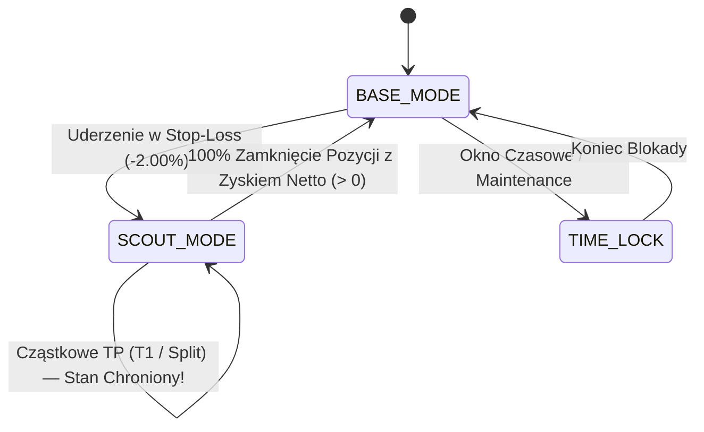
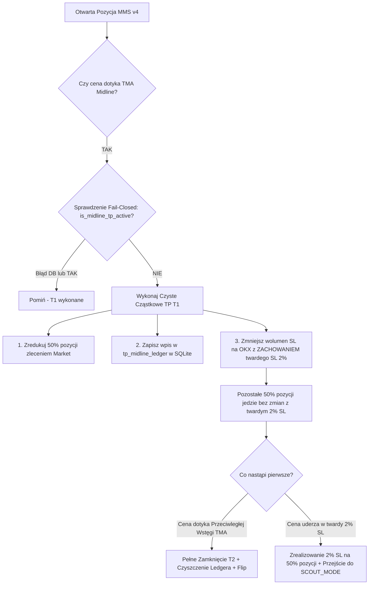
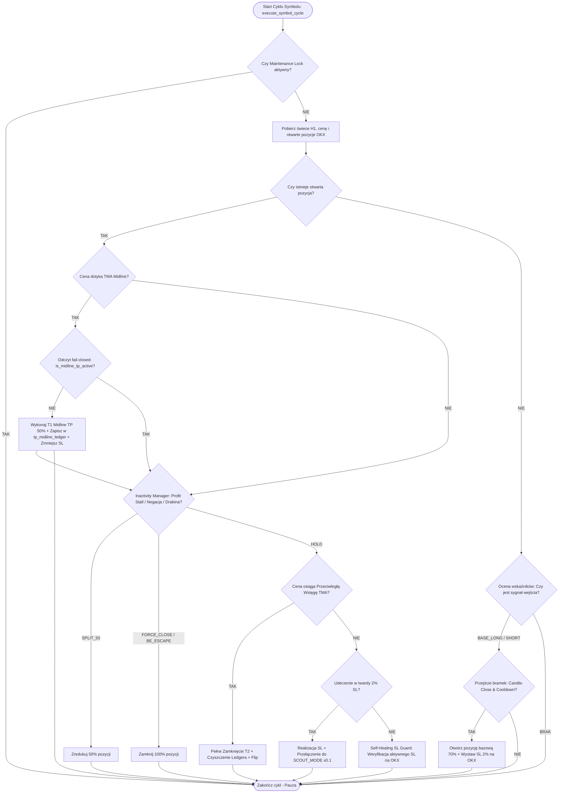

# 📘 MMS v4 (mms4tk) — Strategia i Algorytm Działania

**Wersja dokumentacji:** v0.42.0  
**Data aktualizacji:** 2026-09-02  
**Status:** Wdrożona na produkcji (OKX Perpetual Futures)  
**Standard architektoniczny:** AGENTS-OS v6.5 Swarm / MMS4 Strict Compliance  

---

## 📑 Spis Treści
1. [Wprowadzenie i Filozofia Rynkowa](#1-wprowadzenie-i-filozofia-rynkowa)
2. [Silnik Analityczny i Matematyka Wskaźników](#2-silnik-analityczny-i-matematyka-wskaźników)
3. [Algorytm Generowania Sygnałów Wejścia](#3-algorytm-generowania-sygnałów-wejścia)
4. [Maszyna Stanów i Dynamiczne Skalowanie Lewaru](#4-maszyna-stanów-i-dynamiczne-skalowanie-lewaru)
5. [Wielopoziomowy Algorytm Realizacji Zysków (Dual-Stage TP)](#5-wielopoziomowy-algorytm-realizacji-zysków-dual-stage-tp)
6. [Czas jako Trailing Stop: Inactivity Manager](#6-czas-jako-trailing-stop-inactivity-manager)
7. [Zarządzanie Ryzykiem, Alokacją i Wielkością Pozycji](#7-zarządzanie-ryzykiem-alokacją-i-wielkością-pozycji)
8. [Księgowość PnL Netto i Rozliczanie Prowizji FIFO](#8-księgowość-pnl-netto-i-rozliczanie-prowizji-fifo)
9. [Architektura Wykonawcza i Bezpieczeństwo](#9-architektura-wykonawcza-i-bezpieczeństwo)
10. [Diagram Przepływu Decyzji (Control Flow)](#10-diagram-przepływu-decyzji-control-flow)

---

## 1. Wprowadzenie i Filozofia Rynkowa

System **MMS v4 (Mastermind Strategy v4)** to autonomiczny algorytm handlowy klasy *Mean-Reversion* (powrót do średniej) operujący na kontraktach terminowych **OKX Perpetual Swap (EEA Multi-Collateral X-Perp)** w interwale 1-godzinnym (**H1**).

### 📐 Fundamenty ilościowe:
- **Rozkład Zmienności:** Rynki kryptowalut spędzają 70–80% czasu w konsolidacjach i kanałach horyzontalnych, a jedynie 20–30% w silnych impulsach kierunkowych.
- **Wycena Statystyczna:** Ceny wykraczające poza dynamiczne pasma odchylenia zmienności TMA (*Triangular Moving Average*) ulegają zjawisku over-extension (wyczerpanie chwilowego impetu), co tworzy asymetryczną szansę na zysk z powrotu do mediany.
- **Ochrona przed Trendem (Regime Protection):** Zamiast zawodnych prób przewidywania przyszłych trendów, system stosuje **sekwencyjną Maszynę Stanów (Base vs Scout)**. W razie wystąpienia silnego trendu kierunkowego i uderzenia w twardy Stop-Loss (2.0%), system natychmiast redukuje lewar do poziomu zwiadowczego (x0.1), spłaszczając krzywą kapitału i chroniąc depozyt.

---

## 2. Silnik Analityczny i Matematyka Wskaźników

Sercem analitycznym systemu jest moduł `src/mms4tk/analytics.py`.

```
                  ┌── TMA Upper (TMA Mid + ATR × Multiplier)
                  │
  ════════════════╪══ TMA Mid (Triangular Moving Average)
                  │
                  └── TMA Lower (TMA Mid - ATR × Multiplier)
```

### 2.1. Trójkątna Średnia Krocząca (TMA)
TMA to podwójnie wygładzona średnia prosta SMA, kładąca największą wagę na środkowy punkt okna czasowego (filtracja szumu rynkowego bez nadmiernego opóźnienia fazowego):
$$N_{half1} = \left\lceil \frac{N + 1}{2} \right\rceil, \quad N_{half2} = \left\lfloor \frac{N + 1}{2} \right\rfloor$$
$$TMA(P, N) = SMA\Big(SMA(P, N_{half1}), N_{half2}\Big)$$
*Domyślny okres:* $N = 56$ świec H1.

### 2.2. Dynamiczne Wstęgi ATR (Average True Range)
Wstęgi zmienności kalkulowane są na bazie 14-okresowego wskaźnika ATR:
$$TR_t = \max\Big(High_t - Low_t, \; |High_t - Close_{t-1}|, \; |Low_t - Close_{t-1}|\Big)$$
$$ATR_{14} = EMA(TR, 14)$$
$$TMA_{Upper} = TMA_{Mid} + \big(ATR_{14} \times \text{Band\_Multiplier}\big)$$
$$TMA_{Lower} = TMA_{Mid} - \big(ATR_{14} \times \text{Band\_Multiplier}\big)$$
*Domyślny mnożnik pasma:* $\text{Band\_Multiplier} = 2.5$ do $3.5$ (konfigurowalny per symbol).

### 2.3. Wskaźnik Zmienności (Volatility Ratio - VR)
VR mierzy stosunek zmienności krótkoterminowej do długoterminowej bazy:
$$VR = \frac{ATR_{14}}{ATR_{56}}$$
- **Niska Zmienność ($VR < 0.75$):** Rynek w kompresji, optymalne warunki dla mean-reversion.
- **Normalna Zmienność ($0.75 \le VR \le 1.40$):** Standardowy reżim operacyjny.
- **Wysoka Zmienność ($VR > 1.40$):** Dynamiczne rozszerzanie pasm TMA w celu uniknięcia przedwczesnych wejść w trakcie nagłych wybić.

---

## 3. Algorytm Generowania Sygnałów Wejścia

Sygnały generowane są w module `analytics.py` i podlegają rygorystycznym bramkom bezpieczeństwa.

| Typ Sygnału | Warunek Matematyczny | Udział w Pozycji | SL od Wejścia |
|---|---|---|---|
| `BASE_LONG` | $Low \le TMA_{Lower}$ oraz $Close > Low$ (potwierdzenie odrzucenia dołka) | 70% Alokacji | -2.00% |
| `BASE_SHORT` | $High \ge TMA_{Upper}$ oraz $Close < High$ (potwierdzenie odrzucenia szczytu) | 70% Alokacji | -2.00% |
| `HIGH_RISK_ADD` | Pogłębienie odchylenia o kolejne $1.0 \times ATR$ poza wstęgę | 30% Alokacji | -1.25% |

### 🛡️ Bramki Filtrujące Wejścia:
1. **Candle-Close Gate (`_last_signal_candle_ts`):** 
   Każdy sygnał może zostać wygenerowany maksymalnie **raz na daną świecę H1**. Zapobiega to wielokrotnemu otwieraniu pozycji podczas pojedynczego bara.
2. **Post-SL Cooldown (`_sl_cooldown_until`):** 
   Po uderzeniu w Stop-Loss na danym instrumencie bot nakłada **3-świecowy okres karencji** (3 godziny na H1), blokując natychmiastowe wejścia z zemsty (*revenge trading*).
3. **Trend Filter Recalibration Gate (PLAN-010):**
   Opcjonalny filtr nachylenia TMA (TMA Slope), weryfikowany procedurą dwukierunkowej kalibracji (*2-way train/test split*) po zebraniu minimum 175 czystych transakcji w danym reżimie.

---

## 4. Maszyna Stanów i Dynamiczne Skalowanie Lewaru

Moduł `src/mms4tk/state_manager.py` zarządza cyklem życia portfela i poziomem ryzyka.



### 1. `BASE_MODE` (Tryb Bazowy — Standardowy):
- **Skuteczna dźwignia:** **3.0x** (100% nominalnej alokacji portfela, np. $50 USD na symbol).
- **Struktura wejścia:** 70% kapitału przydzielane na pozycję bazową (`BASE`), 30% rezerwowane na ewentualne uśrednienie (`HIGH_RISK_ADD`).

### 2. `SCOUT_MODE` (Tryb Zwiadowczy — Anty-Trend):
- **Skuteczna dźwignia:** **0.1x** (10% alokacji bazowej).
- **Aktywacja:** Wyzwalana natychmiast po zanotowaniu straty na pełnym Stop-Lossie (2.0%).
- **Cel:** Pozwala systemowi na badanie zachowania rynku mikroskopijnym wolumenem w trakcie silnych trendów kierunkowych. Jeśli rynek nadal uderza w SL, straty wynoszą ułamki centów.
- **🔒 Żelazna Reguła Blokady Scout Mode (v0.42.0):** Cząstkowe wyjścia z zyskiem (np. T1 Midline TP lub Inactivity Split) **nie mają prawa zresetować Scout Mode**. Powrót do `BASE_MODE` następuje wyłącznie po **całkowitym (100%) zamknięciu pozycji z dodatnim wynikiem netto**.

---

## 5. Wielopoziomowy Algorytm Realizacji Zysków (Dual-Stage TP)

Wdrożony w **PLAN-009 v2.0 (v0.42.0)** mechanizm dwuetapowej realizacji zysków eliminuje problem wyparowywania zysków w rejonie linii środkowej bez naruszania matematyki strategii.



### 🎯 Etap 1: Cząstkowe TP na Midline (T1)
- **Warunek aktywacji:** Świeca lub cena bieżąca przecina linię $TMA_{Midline}$:
  - Dla **LONG:** $High \ge TMA_{Mid}$ oraz $Entry \le TMA_{Mid}$.
  - Dla **SHORT:** $Low \le TMA_{Mid}$ oraz $Entry \ge TMA_{Mid}$.
- **Wielkość redukcji:** Dokładnie **50% pozycji** (`midline_tp_fraction = 0.50`), wyliczane z uśrednionego rozmiaru pozycji w środowisku Netting.
- **🛡️ Żelazna Reguła Stop-Loss:** Pozostałe 50% pozycji **NIE przesuwa Stop-Lossa na Break-Even**. Utrzymuje pierwotny, nienaruszony twardy Stop-Loss na poziomie **2.00% od ceny wejścia**, dając rynkowi pełen oddech (*Shallow Zone*) na dokończenie cyklu.
- **🗄️ Dedykowany Ledger `tp_midline_ledger` (Wzorzec Fail-Closed):**
  Zapisywany w SQLite (`PRIMARY KEY (symbol, side)`). W razie awarii bazy lub błędu odczytu, funkcja `is_midline_tp_active()` natychmiast zwraca `True` (*fail-closed*), blokując powtórne rynkowe redukcje podczas pętli rekoncyliacji.

### 🎯 Etap 2: Pełne Wyjście na Przeciwległej Wstędze (T2)
- **Warunek aktywacji:** Cena osiąga przeciwległe pasmo ($TMA_{Upper}$ dla Long, $TMA_{Lower}$ dla Short).
- **Działanie:** 100% zamknięcie pozostałych kontraktów, usunięcie wpisu z `tp_midline_ledger`, rejestracja transakcji i opcjonalne odwrócenie pozycji (*Flip*).

---

## 6. Czas jako Trailing Stop: Inactivity Manager

Moduł `src/mms4tk/inactivity_manager.py` realizuje koncepcję **"Czas zamiast Ciasnego Stop-Lossa"**. Zamiast ucinania zysku wąskim trailing stopem, bot ewakuuje kapitał, gdy wygasa impet czasowy.

```
Reguły Inactivity Managera:
├── 1. Profit Stall Gate ──► Zysk >= 0.6×ATR + brak nowego ATH przez 4 świece ──► SPLIT_50
├── 2. Negacja Impulsu   ──► Impuls >= 0.8×ATR + cofnięcie o >38.2% (Fibonacci) ──► SPLIT_50 / FORCE_CLOSE
├── 3. BE Escape         ──► Po stagnacji cena wraca do wejścia (Zysk >= 0.12% fee buffer) ──► BE_ESCAPE
└── 4. Drabina Stagnacji ──► 12 świec w odległości <0.5×ATR od wejścia ──► SPLIT_50 ──► 5 świec grace ──► FORCE_CLOSE_BE
```

### 6.1. Profit Stall Gate (Stagnacja w Strefie Zysku)
- **Problem:** Pozycja wypracowuje solidny zysk ($uPnL \ge 0.6 \times ATR$), ale zatrzymuje się pod Midline i konsoliduje.
- **Działanie:** Jeśli przez **4 kolejne świece H1** cena nie wybije nowego lokalnego szczytu zysku:
  $$\text{profit\_stall\_candles} \ge 4 \implies \text{Akcja: } \mathbf{SPLIT\_50}$$
  Bot zamyka 50% pozycji zleceniem rynkowym, zabezpieczając wypracowany zysk przed cofnięciem.

### 6.2. Zaostrzona Negacja Impulsu (Fibonacci 38.2%)
- Dla dojrzałych impulsów zysku ($\text{Impuls} \ge 0.8 \times ATR$):
  Poziom negacji wynosi **38.2% zniesienia Fibonacciego** (zamiast 50.0%). Oddanie ponad 1/3 wypracowanego dynamicznego ruchu skutkuje natychmiastowym cięciem 50% pozycji.

### 6.3. Realny Bufor Prowizji w `BE_ESCAPE`
- Wycofanie kapitału na poziomie ceny wejścia następuje tylko wtedy, gdy zysk wynosi co najmniej **+0.12%** (`DEFAULT_ROUND_TRIP_COST_PCT = 0.0012`), co w 100% pokrywa prowizje Taker/Maker na OKX i zapobiega stratom netto (*fee drag*).

---

## 7. Zarządzanie Ryzykiem, Alokacją i Wielkością Pozycji

### 7.1. Hierarchia Parametrów Alokacji (SSOT w SQLite)
Alokacja rozstrzygana jest w kolejności priorytetów:
1. `symbols.json` / SQLite: `allocation_usd` (per symbol)
2. `budget_usd` (per symbol)
3. `MMS4_MAX_MARGIN_USD` (globalny fallback)

### 7.2. Przeliczanie Kontraktów i Wielkości Lotów
Wymiarowanie pozycji uwzględnia specyfikację kontraktu giełdy OKX (*Contract Size*):
- **BTC/USD (X-Perp):** $\text{ContractSize} = 0.0001\text{ BTC}$
- **ETH/USD (X-Perp):** $\text{ContractSize} = 0.001\text{ ETH}$
- **SOL/USD (X-Perp):** $\text{ContractSize} = 0.1\text{ SOL}$

Formuła kalkulacji liczby kontraktów:
$$\text{Notional}_{USD} = \text{Allocation}_{USD} \times \text{Leverage}$$
$$\text{Contracts} = \left\lfloor \frac{\text{Notional}_{USD}}{\text{Price} \times \text{ContractSize}} \right\rfloor$$

*Bezpiecznik mikro-pozycji:* Jeśli wielkość pozycji wynosi $\text{Contracts} < 2$, operacja podziału T1 jest pomijana (`T1_SKIPPED_NOT_DIVISIBLE`), a pozycja kontynuuje w całości z twardym SL 2.0%.

---

## 8. Księgowość PnL Netto i Rozliczanie Prowizji FIFO

Wdrożony w **PLAN-011 (v0.41.0)** silnik `src/mms4tk/trade_sync.py` zapewnia pełną zgodność księgową z historią zleceń na OKX.

```
       [ Otwarcie Pozycji ]               [ Zamknięcie Pozycji / T1 ]
                │                                      │
         Pobranie fee z OKX                     Pobranie fee z OKX
                │                                      │
     Kolejka FIFO: open_fee / size                     │
                └─────────────────►  Dopasowanie FIFO pro-rata:
                                     Total_Fee = Open_Fee_Prorated + Close_Fee
                                     PnL_Net = PnL_Gross - Total_Fee
                                     Win/Loss = (PnL_Net > 0)
```

1. **Rejestracja Nogi Otwierającej:** Pobranie rzeczywistych prowizji `fee` ze zrealizowanego zlecenia OKX i zapisanie jednostkowego kosztu wejścia:
   $$\text{open\_fee\_per\_unit} = \frac{\text{fee}_{USD}}{\text{size}}$$
2. **Dopasowanie FIFO przy Wyjściu:** Przy zamknięciu (całkowitym lub cząstkowym np. 50%):
   $$\text{Fee}_{Total} = (\text{consumed\_size} \times \text{open\_fee\_per\_unit}) + \text{fee}_{Close}$$
   $$\text{PnL}_{Net} = \text{PnL}_{Gross} - \text{Fee}_{Total}$$
3. **Prawdziwy Win Rate Netto:** Wszystkie statystyki portfela, wykres krzywej kapitału (*Equity Curve*) oraz powiadomienia Telegram klasyfikują transakcję jako wygraną wyłącznie, gdy $\text{PnL}_{Net} > 0$.

---

## 9. Architektura Wykonawcza i Bezpieczeństwo

### 9.1. Integracja Zleceń OKX Algo
Wszystkie zlecenia Stop-Loss składane są bezpośrednio na silniku giełdy jako zlecenia warunkowe (`ordType = "conditional"`):
- Automatyczna konwersja symbolu CCXT na natywny identyfikator OKX: `to_native_inst_id("ETH/USD:USD-310404")` $\rightarrow$ `ETH-USD_UM_XPERP-310404`.
- **Self-Healing SL Guard:** Pętla daemona w każdym cyklu weryfikuje obecność aktywnego zlecenia Stop-Loss na giełdzie. W razie braku zlecenia (np. po restarcie lub odrzuceniu przez giełdę), strażnik natychmiast odtwarza zlecenie na poziomie -2.00%.

### 9.2. Zero-Loss Maintenance Lock
Przed jakimikolwiek pracami diagnostycznymi, aktualizacjami kodu lub restartem, system zakłada blokadę `MAINTENANCE_LOCK` (`scripts/maintenance.py --enable`). Blokada w 100% wstrzymuje składanie nowych zleceń rynkowych na giełdzie do momentu zakończenia prac i weryfikacji testów.

---

## 10. Diagram Przepływu Decyzji (Control Flow)

Pełny cykl decyzyjny wykonywany w pętli daemona co 15 sekund:



---

## 📊 Podsumowanie Kluczowych Wartości Parametrów

| Parametr | Wartość | Plik Źródłowy | Opis |
|---|---|---|---|
| **Interwał Świec** | `H1` (1 godzina) | `daemon.py` | Bazowy horyzont czasowy strategii |
| **Okres TMA** | `56` świec | `analytics.py` | Długość podwójnie wygładzonej średniej trójkątnej |
| **Mnożnik Wstęg TMA** | `2.5 – 3.5` | `analytics.py` | Odchylenie pasm zmienności ATR |
| **Twardy Stop-Loss** | `2.00%` | `daemon.py`, `config.py` | Niezmienny bufor obronny od ceny wejścia |
| **Cząstkowe TP (T1)** | `50%` | `analytics.py`, `daemon.py` | Redukcja pozycji na linii środkowej TMA |
| **Profit Stall Gate** | `4 świece` | `inactivity_manager.py` | Próg stagnacji w zysku ($\ge 0.6 \times ATR$) |
| **Negacja Impulsu** | `38.2%` (Fibonacci) | `inactivity_manager.py` | Próg ucięcia pozycji przy cofnięciu od szczytu |
| **Bufor Prowizji BE** | `0.12%` | `inactivity_manager.py` | Minimalny zysk dla ucieczek `BE_ESCAPE` |
| **Dźwignia Base** | `3.0x` | `state_manager.py` | Dźwignia w trybie standardowym (`BASE_MODE`) |
| **Dźwignia Scout** | `0.1x` | `state_manager.py` | Dźwignia w trybie anty-trendowym (`SCOUT_MODE`) |
