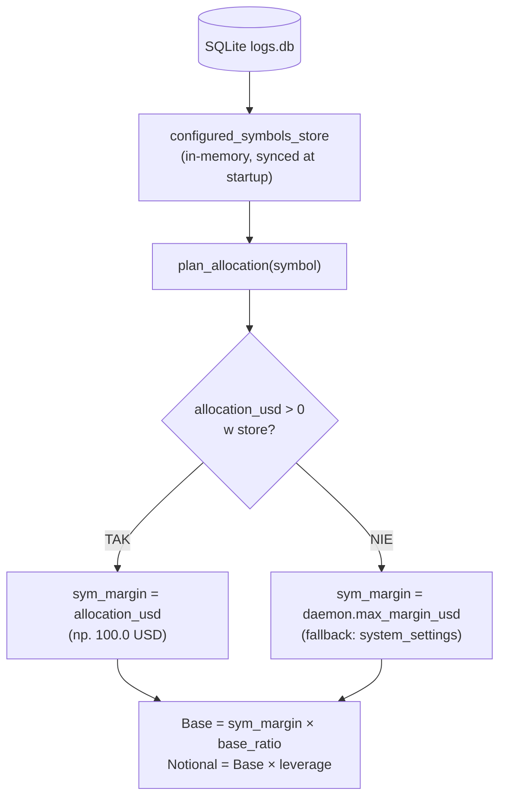

# 🎯 PLAN-003: Eliminacja zaszłości .env & Naprawa hierarchii alokacji w SQLite SSOT

**Wersja**: 2.0 (po głębokiej weryfikacji kodu)
**Status**: GOTOWY DO ZATWIERDZENIA

---

## 📌 Cel i Kontekst

Bot otworzył pozycję na BTC z depozytem **$12.99 USD** zamiast **$100.00 USD**.
Root cause: warunek w `daemon.py:plan_allocation` (L294) porównywał runtime `max_margin_usd` z wartością `.env`.
Gdy globalny margines był zmieniony w UI → warunek `False` → per-symbolowa alokacja ignorowana → fallback do globalnego.

---

## ✅ Wyniki Głębokiej Weryfikacji Kodu (26.08.2026)

> [!IMPORTANT]
> **OBECNY STAN PRODUKCJI JEST BEZPIECZNY.**
> `.env: MMS4_MAX_MARGIN_USD = 10.0` == `daemon.max_margin_usd = 10.0` (z DB) → warunek `True` → alokacja $100 działa.
> Bug ujawnił się jednorazowo gdy operator zmienił globalny margines na $20 USD przez UI.

### Wyniki audytu per-plik

| Plik | Linia | Problem | Severity | Priorytet w Planie |
|---|---|---|---|---|
| `daemon.py` | L293-297 | Brudny warunek `.env`-compare w `plan_allocation` | 🔴 HIGH | **P1 MUSI** |
| `daemon.py` | L1406-1410 | `get_status()` czyta `engine_mode/VR/time_lock` z `os.getenv` zamiast DB | 🟡 MEDIUM | **P2 POWINIEN** |
| `daemon.py` | L102 | Init `max_margin_usd` z `os.getenv` | 🟢 INFO | Akceptowalny* |
| `api.py` | L874-878 | Fallback `os.getenv` w `get_settings()` | 🟢 INFO | Nieistotny* |
| `api.py` | L1002-1006 | Fallback `os.getenv` w `update_settings()` response | 🟢 INFO | Nieistotny* |
| `api.py` | L906, L920, L910 | `persist_env_config` zapisuje runtime params do `.env` | 🟡 MEDIUM | **P3 MUSI** |
| `state_manager.py` | L59-60 | `BASE_ALLOCATION` i `ADDON_ALLOCATION` z `os.getenv` | 🟢 INFO | Akceptowalny* |

> \* **Wyjaśnienie "Akceptowalny/Nieistotny"**:
> - `daemon.py:L102` — `os.getenv` init to normalny startup pattern. `sync_settings_from_db()` wywołane PRZED startem cyklu nadpisuje `daemon.max_margin_usd` z DB. **Nie jest to bug.**
> - `api.py:L874-878` i `L1002-1006` — `sync_settings_from_db()` (L843 w api.py) jest wywoływane przy imporcie modułu i syncuje DB → `os.environ`. Dlatego `os.getenv()` w tych miejscach de facto czyta wartość z bazy, tylko z dodatkowym krokiem przez `os.environ`. Redundantne, ale poprawne.
> - `state_manager.py:L59-60` — stałe obliczane przy imporcie. `daemon.base_allocation` jest nadpisywane przez `api.py:L895-898` przy zmianie. Nie wpływa na runtime.

---

## 🔴 P1 — OBOWIĄZKOWE: Naprawa `plan_allocation` w `daemon.py`

### Problem (L293-297)
```python
# AKTUALNY KOD — BŁĘDNY
default_env_margin = float(os.getenv("MMS4_MAX_MARGIN_USD", os.getenv("MMS4_TRADE_AMOUNT_USD", "10.0")))
if sym_cfg.get("allocation_usd") is not None and abs(self.max_margin_usd - default_env_margin) < 1e-6:
    sym_margin_usd = float(sym_cfg["allocation_usd"])
elif sym_cfg.get("budget_usd") is not None and abs(self.max_margin_usd - default_env_margin) < 1e-6:
    sym_margin_usd = float(sym_cfg["budget_usd"])
```

### Fix (czysta hierarchia SSOT)
```python
# NOWY KOD — CZYSTY
if sym_cfg.get("allocation_usd") is not None and float(sym_cfg["allocation_usd"]) > 0:
    sym_margin_usd = float(sym_cfg["allocation_usd"])
elif sym_cfg.get("budget_usd") is not None and float(sym_cfg["budget_usd"]) > 0:
    sym_margin_usd = float(sym_cfg["budget_usd"])
```

**Weryfikacja efektów ubocznych**:
- ✅ `base_ratio` / `addon_ratio` — bez zmian, ten kod pozostaje poniżej (L299-301)
- ✅ Addon notional — używa `sym_margin_usd * addon_ratio` — prawidłowe
- ✅ `margin_cap_usd` w UI — czyta `sym_margin_usd * size_mult` — prawidłowe
- ✅ Scenariusz "brak wpisu per-symbol" — gdy `sym_cfg` jest puste `{}`, oba warunki `False` → `sym_margin_usd = self.max_margin_usd` (fallback globalny L282) — prawidłowe
- ✅ Scenariusz `allocation_usd = 0` (wyłączony?) — guard `float() > 0` chroni przed zerem jako kwotą aktywną

> [!NOTE]
> `configured_symbols_store` jest poprawnie inicjalizowane PRZED startem pętli demona.
> `plan_allocation()` jest wywoływane wewnątrz cyklu, więc zawsze ma dostęp do aktualnego store.

---

## 🟡 P2 — OBOWIĄZKOWE: Naprawa `get_status()` w `daemon.py` (L1406-1410)

### Problem
```python
"engine_mode": os.getenv("MMS4_ENGINE_MODE", "CLASSIC"),   # L1406
"adaptive_vr_high": float(os.getenv("MMS4_ADAPTIVE_VR_HIGH", "1.6")),
"adaptive_vr_low": float(os.getenv("MMS4_ADAPTIVE_VR_LOW", "0.8")),
"time_lock_start": os.getenv("MMS4_TIME_LOCK_START", "13:30"),
"time_lock_end": os.getenv("MMS4_TIME_LOCK_END", "14:30"),
```

`sync_settings_from_db()` syncuje DB→`os.environ` przy starcie, więc w 99% przypadków działa. Jednak jest to kruchy design — pośredni odczyt przez `os.environ` zamiast bezpośrednio z DB.

**Weryfikacja produkcyjna**: `MMS4_ENGINE_MODE = 'ADAPTIVE'` w `os.environ` na VPS — to poprawna wartość z DB, nie relikt `.env`.

### Fix
```python
db_snap = self.logger_db.get_all_settings() if self.logger_db else {}
# ...
"engine_mode": db_snap.get("engine_mode", "CLASSIC"),
"adaptive_vr_high": float(db_snap.get("adaptive_vr_high", 1.6)),
"adaptive_vr_low": float(db_snap.get("adaptive_vr_low", 0.8)),
"time_lock_start": db_snap.get("time_lock_start", "13:30"),
"time_lock_end": db_snap.get("time_lock_end", "14:30"),
```

---

## 🔴 P3 — OBOWIĄZKOWE: Eliminacja zapisu runtime params do `.env`

### Problem (`api.py:update_settings()`)

Przy każdej zmianie ustawień przez UI, `persist_env_config` zapisuje do `.env`:
- L906: `MMS4_MAX_MARGIN_USD` → `.env`
- L910: `MMS4_BASE_SL_PCT` → `.env`
- L899: `MMS4_BASE_ALLOCATION` / `MMS4_ADDON_ALLOCATION` → `.env`
- L920: `MMS4_TOTAL_MAX_PORTFOLIO_MARGIN_USD` → `.env`

> [!CAUTION]
> **TO JEST WADA ARCHITEKTONICZNA REGENERUJĄCA BUG PO KAŻDYM REBUILD.**
> Scenariusz: Operator zmienia `max_margin_usd` → 20 USD przez UI → P3 zapisuje `MMS4_MAX_MARGIN_USD=20.0` do `.env` → rebuild kontenera → daemon startuje z `os.getenv → 20.0` → nawet po naprawie P1 `abs(20.0 - 20.0) = 0 < 1e-6` → działa. ALE następna zmiana UI do $15 → `abs(15.0 - 20.0) = 5.0 > 1e-6` → bug wraca.
>
> **P3 jest WYMAGANE do trwałej naprawy P1.**

### Fix — usunąć z `env_updates` w `update_settings()`:
```python
# Usunąć te linie (SQLite = SSOT, nie .env):
# env_updates["MMS4_MAX_MARGIN_USD"] = str(daemon.max_margin_usd)
# env_updates["MMS4_BASE_SL_PCT"] = str(daemon.base_sl_pct)
# env_updates["MMS4_BASE_ALLOCATION"] = str(daemon.base_allocation)
# env_updates["MMS4_ADDON_ALLOCATION"] = str(daemon.addon_allocation)
# env_updates["MMS4_TOTAL_MAX_PORTFOLIO_MARGIN_USD"] = str(cap_val)
```

Zachować `persist_env_config` tylko dla: `MMS4_ENGINE_MODE`, `MMS4_ADAPTIVE_VR_*`, `MMS4_TIME_LOCK_*` (do momentu gdy `get_status()` będzie czytać je z DB — po P2 można usunąć też te).

---

## 📋 Testy — `tests/test_allocation_ssot.py`

### Analiza istniejącego `conftest.py`
- `_no_real_okx_network`: patche OKXExecutor — reużywalne ✅
- `_isolate_system_settings`: resetuje `engine_mode`, VR, time_lock, `total_max_portfolio_margin_usd`.
  - ❗ **NIE resetuje `configured_symbols_store` ani `max_margin_usd`** — nowe testy muszą zarządzać tym samodzielnie (via `monkeypatch`).

### 5 testów do napisania

| # | Funkcja testowa | Scenariusz | Oczekiwany wynik |
|---|---|---|---|
| 1 | `test_per_symbol_allocation_overrides_global` | `allocation_usd=100`, `max_margin_usd=20`, lewar 3x | `margin_base_usd=70.0`, `notional_base_usd=210.0` |
| 2 | `test_global_fallback_when_no_per_symbol` | Brak wpisu per-symbol, `max_margin_usd=20` | `margin_base_usd=14.0`, `notional_base_usd=42.0` |
| 3 | `test_allocation_survives_margin_change` | `allocation_usd=100`, potem zmiana `max_margin_usd=50` | Nadal `margin_base_usd=70.0` |
| 4 | `test_allocation_zero_guard` | `allocation_usd=0.0` w store | Fallback do globalnego (nie zeruje pozycji) |
| 5 | `test_budget_usd_fallback` | `budget_usd=50` (brak `allocation_usd`) | `margin_base_usd=35.0` |

---

## 🚦 Scope Finalny PLAN-003

```
P1 OBOWIĄZKOWE:  daemon.py L293-297   — usunięcie warunku abs(...)
P2 OBOWIĄZKOWE:  daemon.py L1406-1410 — get_status() z DB zamiast os.getenv
P3 OBOWIĄZKOWE:  api.py update_settings() — stop zapisywania runtime params do .env
T1 OBOWIĄZKOWE:  tests/test_allocation_ssot.py — 5 testów negatywnych
```

Scope NIE OBEJMUJE (odrzucone jako bezpieczne):
- `api.py:L874-878` i `L1002-1006` — akceptowalne, nie zmieniamy
- `daemon.py:L102` — akceptowalny startup init
- `state_manager.py:L59-60` — akceptowalny moduł-level constant

---

## 📊 Hierarchia alokacji po naprawie



---

## 🏗️ Procedura Wdrożenia (Swarm Triad Protocol)

1. **Operator** zatwierdza ten plan.
2. **Builder subagent** implementuje P1+P2+P3+T1 w izolowanym kontekście.
3. **Auditor subagent** generuje `*_auditor_handshake.json`.
4. Testy lokalne: `pytest tests/test_allocation_ssot.py tests/test_adaptive_tactics.py -v`
5. Zero-Loss Maintenance Lock: `python3 scripts/maintenance.py --enable`
6. VPS Deploy: rebuild → `GET /api/v1/daemon/status` → verify `allocation_plan["BTC/USDC"].margin_cap_usd == 100.0`
7. Unlock: `python3 scripts/maintenance.py --disable`
8. Version Bump: `0.33.1` → `0.33.2` (PATCH)
