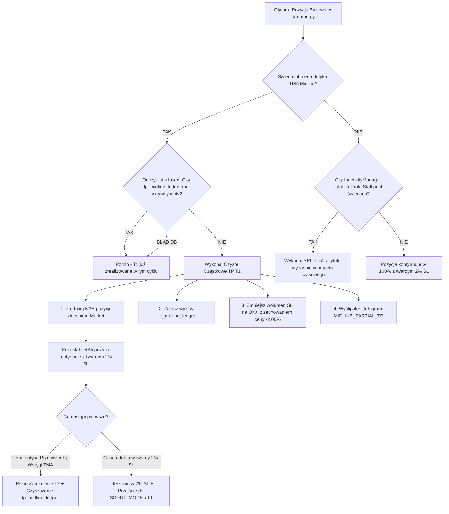

# 📋 PLAN-009 (v2.0): Midline Partial Take Profit & Dynamic Inactivity Management

**Status:** Approved by Operator (Ready for Worktree Implementation)  
**Standard:** AGENTS-OS v6.5 Swarm / MMS4 Strict Compliance  
**Target Version:** v0.42.0  
**Git Worktree Target:** `tmp/worktrees/feat-plan-009-midline-tp-inactivity`

---

## 1. 🎯 Objectives & Quantitative Rationale

### 📐 Fundament Matematyczny MMS4:
Strategia powrotu do średniej (mean-reversion) wymaga pełnej przestrzeni na naturalne fluktuacje rynkowe (*Shallow Zone*). Przesuwanie zlecenia Stop Loss na poziom Break-Even lub stosowanie kroczącego Trailing Stopu zamienia bota w darmowego dawcę płynności dla rynkowego szumu i degraduje wartość oczekiwaną ($EV$) strategii.
- **Jedyny Mur Obronny:** Niezmienny, twardy **Stop Loss na poziomie 2.00%** od ceny wejścia.
- **Czas jako Trailing Stop:** Zamiast ucinania zysku wąskim Stop-Lossem, używamy upływu czasu i braku impetu w `MMS4InactivityManager` do ewakuacji kapitału z wyhamowanych pozycji.
- **Obrona przed Trendem:** **Maszyna Stanów MMS4**. W razie uderzenia w twardy 2% SL, system natychmiast zrzuca lewar do poziomu zwiadowczego **Scout Mode (x0.1)**.

### 🎯 Cele PLAN-009:
1. **Czyste Cząstkowe TP (T1):** Zamknięcie dokładnie **50% pozycji (`midline_tp_fraction = 0.50`)** na linii środkowej TMA (TMA Midline), de-ryzykując ekspozycję notional o połowę.
2. **Bezwzględny Twardy Stop Loss 2.0% (Zakaz BE):** Pozostałe 50% pozycji **NIE zmienia poziomu Stop Lossa na Break-Even**. Utrzymuje pierwotny, twardy Stop Loss 2.00%, dając rynkowi pełną swobodę dotarcia do przeciwległej wstęgi TMA (T2).
3. **Optymalizacje `MMS4InactivityManager`:**
   - *Profit Stall Gate:* uPnL $\ge 0.6 \times \text{ATR}$ + brak nowego ATH przez 4 kolejne świece H1 $\rightarrow$ `SPLIT_50`.
   - *Negacja Impulsu 38.2%:* Dla impulsów $\ge 0.8 \times \text{ATR}$ próg zniesienia zaostrzony do 38.2% Fibonacciego.
   - *Bufor Prowizji:* Próg dla ucieczek `BE_ESCAPE` podniesiony do 0.12% (`0.0012`).
4. **Dedykowany Ledger `tp_midline_ledger` (Fail-Closed):**
   - Stan wykonania T1 utrwalany w dedykowanej tabeli `tp_midline_ledger` (kluczowanej po symbolu i kierunku).
   - Wzorzec odczytu **fail-closed** (w razie wątpliwości lub błędu odczytu stan uznawany za wykonany, co kategorycznie blokuje wielokrotne zlecanie redukcji podczas pętli rekoncyliacji).
5. **Ochrona Maszyny Stanów:**
   - Częściowe TP (Midline lub Split 50%) ma **bezwzględny zakaz** resetowania dźwigni ze stanu `SCOUT_MODE` (x0.1) do `BASE_MODE` (x1.0). Reset wyłącznie po całkowitym zamknięciu pozycji z zyskiem netto.

---

## 2. 🏗️ Architektura i Przepływ Kontroli (Control Flow)



---

## 3. 🗄️ Model Danych SQLite: `tp_midline_ledger`

Dedykowana tabela w `logger_db.py` (`logs.db`):

```sql
CREATE TABLE IF NOT EXISTS tp_midline_ledger (
    symbol TEXT NOT NULL,
    side TEXT NOT NULL,
    entry_price REAL NOT NULL,
    midline_price REAL NOT NULL,
    reduced_contracts REAL NOT NULL,
    remaining_contracts REAL NOT NULL,
    pnl_usd REAL NOT NULL,
    executed_at TEXT NOT NULL,
    is_active INTEGER NOT NULL DEFAULT 1,
    PRIMARY KEY (symbol, side)
);
```

### Metody CRUD w `LoggerDB`:
1. `record_midline_tp(symbol: str, side: str, entry_price: float, midline_price: float, reduced_contracts: float, remaining_contracts: float, pnl_usd: float)`:
   - Wstawia lub aktualizuje rekord z `is_active = 1`.
2. `is_midline_tp_active(symbol: str, side: str) -> bool`:
   - **Wzorzec Fail-Closed:**
   ```python
   def is_midline_tp_active(self, symbol: str, side: str) -> bool:
       try:
           with sqlite3.connect(self.db_path, timeout=5.0) as conn:
               cursor = conn.cursor()
               cursor.execute(
                   "SELECT is_active FROM tp_midline_ledger WHERE symbol = ? AND side = ? AND is_active = 1",
                   (symbol, side.lower())
               )
               row = cursor.fetchone()
               return bool(row and row[0] == 1)
       except Exception as e:
           logger.error(f"FAIL-CLOSED: Błąd odczytu tp_midline_ledger dla {symbol}/{side}: {e}. Przyjmuję True.")
           return True  # Fail-closed: blokada ponownego zlecenia
   ```
3. `clear_midline_tp(symbol: str, side: str)`:
   - Ustawia `is_active = 0` (lub usuwa wpis) po pełnym zamknięciu pozycji.

---

## 4. 📝 Podział na Zadania Implementacyjne (Developer Tickets)

### 🔹 TICKET-1: Optymalizacje `MMS4InactivityManager`
- **Plik docelowy:** `src/mms4tk/inactivity_manager.py`
- **Zakres:**
  1. *Profit Stall Gate:* Jeśli uPnL $\ge 0.6 \times \text{ATR}$, brak nowego ATH zysku przez 4 kolejne świece H1 (`profit_stall_candles >= 4`) emituje `StaleAction.SPLIT_50`.
  2. *Negacja Impulsu:* Dla impulsów $\ge 0.8 \times \text{ATR}$ próg zniesienia obniżony do **38.2%** Fibonacciego.
  3. *Realny Bufor Prowizji:* `DEFAULT_ROUND_TRIP_COST_PCT = 0.0012` (0.12%).

### 🔹 TICKET-2: Tabela `tp_midline_ledger` & Fail-Closed Pattern
- **Plik docelowy:** `src/mms4tk/logger_db.py`
- **Zakres:**
  1. Utworzenie tabeli `tp_midline_ledger` w `_init_db()`.
  2. Implementacja metod `record_midline_tp()`, `is_midline_tp_active()` (z logiką fail-closed) oraz `clear_midline_tp()`.

### 🔹 TICKET-3: Pętla Daemona & Netting Execution
- **Pliki docelowe:** `src/mms4tk/daemon.py`, `src/mms4tk/analytics.py`, `src/mms4tk/okx_executor.py`
- **Zakres:**
  1. Wykrywanie przecięcia linii środkowej TMA na świecach H1.
  2. Sprawdzenie `is_midline_tp_active(symbol, side)`.
  3. Wykonanie czystej redukcji 50% pozycji (`midline_tp_fraction = 0.50`) od uśrednionego rozmiaru pozycji (Netting).
  4. Zmniejszenie wolumenu zlecenia `conditional` SL na OKX do pozostałych 50% z **bezwzględnym zachowaniem ceny aktywacji -2.00%**.
  5. Bezpieczna obsługa mikro-pozycji 1-kontraktowych (`T1_SKIPPED_NOT_DIVISIBLE`).
  6. Priorytet: `MIDLINE_PARTIAL_TP` ma bezwzględne pierwszeństwo przed `SPLIT_50`.

### 🔹 TICKET-4: Ochrona Maszyny Stanów (`MMS4StateManager`)
- **Plik docelowy:** `src/mms4tk/state_manager.py`
- **Zakres:**
  1. W `record_trade()`: zablokowanie resetu dźwigni ze stanu `SCOUT_MODE` (x0.1) do `BASE_MODE` (x1.0) przy wyjściach cząstkowych (`is_partial=True` lub `remaining_contracts > 0`).
  2. Reset dozwolony **wyłącznie po 100% zamknięciu pozycji** z zyskiem netto.

### 🔹 TICKET-5: Powiadomienia Telegram & UI Dashboard
- **Pliki docelowe:** `src/mms4tk/hermes_webhook.py`, `scripts/hermes/mms4tk_position_close_monitor.py`, `ui_dashboard/src/components/SettingsTab.jsx`
- **Zakres:**
  1. Nowe szablony alertów Telegram: `MIDLINE_PARTIAL_TP` oraz `PROFIT_STALL_SPLIT`.
  2. Udostępnienie parametrów `midline_partial_tp_enabled` i `midline_tp_fraction` w UI Settings.

### 🔹 TICKET-6: Adversarial Test Suite & Weryfikacja Bramki
- **Plik docelowy:** `tests/test_midline_inactivity_tp.py`
- **Zakres:**
  1. Testy Profit Stall Gate (4 świece).
  2. Testy negacji impulsu 38.2% i bufora 0.12% BE escape.
  3. Testy wzorca fail-closed w `tp_midline_ledger`.
  4. Testy zachowania twardego 2% SL po redukcji Midline.
  5. Adversarial tests: mikro-pozycja 1 kontrakt, restart w trakcie cyklu, blokada resetu Scout Mode.
  6. Zaliczenie 100% pełnej bazy testowej (236+ testów).
  7. Podbicie wersji do **`v0.42.0`** (4 pliki SSOT).

---

## 🛡️ Punkty Kontrolne dla Auditora (Adversarial Testing Controls)
- [ ] **Test Niepodzielności:** Pozycja o wielkości 1 kontraktu pomija T1 i nie zgłasza błędu podziału.
- [ ] **Test Fail-Closed:** Symulacja błędu SQLite w trakcie sprawdzania `is_midline_tp_active()` zwraca `True` i blokuje podwójną redukcję.
- [ ] **Test Odporności na Restart:** Restart kontenera po wykonaniu T1 poprawnie odczytuje `tp_midline_ledger` i nie wysyła ponownego zlecenia.
- [ ] **Test Nienaruszonego SL:** Zlecenie `conditional` SL na OKX ma zmniejszony wolumen, ale niezmienioną cenę aktywacji (-2.00%).
- [ ] **Test Blokady Maszyny Stanów:** Wykonanie zyskownego T1 w stanie `SCOUT_MODE` pozostawia symbol w `SCOUT_MODE` aż do pełnego zamknięcia.
