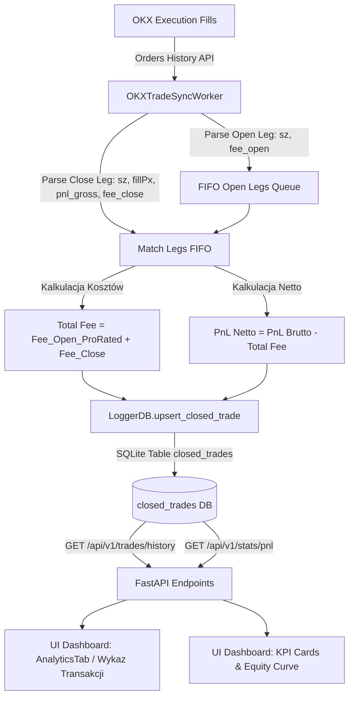

# 📋 PLAN-011: Fee Tracking & Net PnL Accounting (OKX Real Trading Fees)

**Status:** Proposed (Ready for user review)  
**Standard:** AGENTS-OS v6.5 Swarm  
**Target Version:** v0.41.0  

---

## 1. 🎯 Objectives & Problem Statement

### 🔍 Zdiagnozowany problem:
W Wykazie Transakcji bot prezentuje **PnL Brutto** (np. `+$0.04 USD`), podczas gdy w historii giełdy OKX ta sama pozycja odnotowuje rzeczywistą stratę netto (np. `-$0.10 USD`).
- **Przyczyna:** Każda transakcja na OKX (otwarcie i zamknięcie pozycji) pobiera prowizję transakcyjną (Taker fee ~0.05%, Maker fee ~0.02%). Przy obrocie $150–$300 notional prowizje obu nóg transakcji wynoszą łącznie **~$0.14–$0.18 USD**.
- Gdy zysk z ruchu ceny wynosi $+0.04 USD$, po odliczeniu prowizji realny bilans kapitału wynosi $-0.10 USD$.
- **Skutek braku rozliczenia prowizji:** Operator ma złudne poczucie zyskowności mikro-transakcji ("WIN 🟢"), podczas gdy konto powoli traci kapitał na prowizjach (tzw. *fee drag*).

### 🎯 Cel wdrożenia:
1. **Pełna transparentność kosztów transakcyjnych:** Rejestrowanie rzeczywistych opłat giełdowych pobranych przez OKX dla każdej pozycji (otwarcie + zamknięcie).
2. **Rozróżnienie PnL Brutto vs PnL Netto:** W bazie SQLite, API, wykresach i tabelach prezentujemy zarówno czysty zysk z ruchu ceny (Gross), sumę prowizji (Fees), jak i realny wynik na koncie (Net).
3. **Prawdziwy Win Rate i Realistyczne KPI:** Oznaczenie `WIN 🟢` wyłącznie dla transakcji, które po potrąceniu prowizji przyniosły zysk netto (`pnl_net_usd > 0`).

---

## 2. 🏗️ Architektura i Przepływ Danych (Data Flow)



---

## 3. 📝 Szczegółowy Zakres Zmian (Implementation Steps)

### 3.1. Baza Danych: Migracja i Schema (`src/mms4tk/logger_db.py`)
1. **Rozszerzenie schematu tabeli `closed_trades`:**
   - `fee_usd REAL NOT NULL DEFAULT 0.0` — łączna suma prowizji (otwarcie + zamknięcie).
   - `pnl_net_usd REAL NOT NULL DEFAULT 0.0` — wynik transakcji po potrąceniu prowizji (`pnl_usd - fee_usd`).
2. **Automatyczna migracja istniejącej bazy:**
   - W metodzie `_init_db()` dodać bezpieczne dodawanie kolumn dla istniejących baz:
     ```python
     cursor.execute("PRAGMA table_info(closed_trades)")
     cols = [c["name"] for c in cursor.fetchall()]
     if "fee_usd" not in cols:
         cursor.execute("ALTER TABLE closed_trades ADD COLUMN fee_usd REAL NOT NULL DEFAULT 0.0")
     if "pnl_net_usd" not in cols:
         cursor.execute("ALTER TABLE closed_trades ADD COLUMN pnl_net_usd REAL NOT NULL DEFAULT 0.0")
     ```
3. **Aktualizacja `upsert_closed_trade()` oraz `get_closed_trades()`** o obsługę nowych pól.

---

### 3.2. Synchronizacja i Kojarzenie Prowizji (`src/mms4tk/trade_sync.py`)
1. **Pobieranie pola `fee` z każdego zlecenia OKX:**
   - W surowym obiekcie zlecenia OKX pole `fee` zwraca np. `"-0.0390179"` (wartość ujemna).
   - Przechowujemy `fee_usd = abs(float(item.get("fee") or 0.0))`.
2. **Kolejka FIFO dla otwierających nóg (`open_legs`):**
   - Przy rejestrowaniu otwarcia pozycji (`side=sell posSide=short` lub `side=buy posSide=long`) zapisujemy jednostkową prowizję wejścia: `open_fee_per_unit = fee / size`.
3. **Rozliczenie przy zamykaniu pozycji (`is_close`):**
   - Pobieramy proporcjonalną prowizję otwarcia skojarzonych jednostek: `open_fee = consumed_size * open_fee_per_unit`.
   - Łączna prowizja transakcji: `total_fee = open_fee + close_fee`.
   - PnL Netto: `pnl_net_usd = f["pnl_usd"] - total_fee`.
   - Wynik zwycięstwa: `is_win = pnl_net_usd > 0`.

---

### 3.3. API i Statystyki (`src/mms4tk/api.py`)
1. **Endpoint `GET /api/v1/trades/history`:**
   - Zwraca rekordy z polami: `pnl_usd` (brutto), `fee_usd` (prowizje), `pnl_net_usd` (netto).
2. **Endpoint `GET /api/v1/stats/pnl`:**
   - Zwraca zagregowane metryki:
     - `realized_gross_pnl_usd`: suma `pnl_usd`.
     - `total_fees_usd`: suma `fee_usd`.
     - `realized_net_pnl_usd`: suma `pnl_net_usd`.
     - `net_win_rate_pct`: procent transakcji z `pnl_net_usd > 0`.

---

### 3.4. Interfejs Użytkownika (`ui_dashboard/src/components/AnalyticsTab.jsx`)
1. **Wykaz Transakcji (Tabela):**
   - Dodanie dedykowanej kolumny **"Prowizje ($)"** (np. `-$0.14`).
   - W kolumnie PnL prezentacja dwupoziomowa:
     - **PnL Netto (główna wartość):** `-$0.10 USD` (kolor czerwony/zielony zależnie od Netto).
     - **PnL Brutto (podpis):** `Brutto: +$0.04 USD`.
   - Status `WIN 🟢` / `LOSS 🔴` bazujący na rzeczywistym wyniku Netto.
2. **Karty KPI i Krzywa Salda (Equity Curve):**
   - Wykres krzywej kapitału rysowany w oparciu o `pnl_net_usd` (prawdziwy stan portfela).
   - W nagłówku dodanie kafelka: **Łączne Prowizje OKX**.

---

## 4. 🧪 Plan Weryfikacji i Testów

### Testy Automatyczne (`tests/test_fee_tracking.py`):
1. **Test migracji bazy SQLite:** Weryfikacja dodania kolumn `fee_usd` i `pnl_net_usd` bez utraty danych historycznych.
2. **Test FIFO Fee Matching w `trade_sync.py`:** Weryfikacja, czy otwarcie pozycji za $0.05 prowizji i zamknięcie za $0.05 prowizji poprawnie sumuje `fee_usd = 0.10` i wylicza `pnl_net = pnl_gross - 0.10`.
3. **Test częściowego zamykania (`SPLIT_50`):** Weryfikacja, że zamknięcie 50% pozycji pobiera tylko 50% prowizji wejścia.
4. **Test klasyfikacji WIN/LOSS:** Transakcja z `pnl_gross = +0.04` i `fee = 0.10` (`pnl_net = -0.06`) jest poprawnie klasyfikowana jako `is_win = 0` (LOSS).

### Weryfikacja Manualna / E2E:
- Sprawdzenie na żywo zlecenia z 30.08 (pozycja 19 kontraktów BTC):
  - 9 kontraktów: Gross -$0.0008, Fee $0.070, Net -$0.071
  - 10 kontraktów: Gross +$0.0413, Fee $0.078, Net -$0.037
  - Łączny bilans: Gross +$0.0405, Prowizje $0.148, Net -$0.108.

---

## 🚀 Kolejność Wdrożenia (Swarm SDLC)
1. **Praca w izolowanym worktree:** `tmp/worktrees/feat-plan-011-fee-tracking`
2. **Implementacja backendu:** `logger_db.py`, `trade_sync.py`, `api.py`
3. **Implementacja UI:** `AnalyticsTab.jsx`
4. **Testy jednostkowe i regresyjne:** Pełna bramka testowa (225+ testów).
5. **Builder Handshake & 4-file version bump:** `v0.41.0`.
