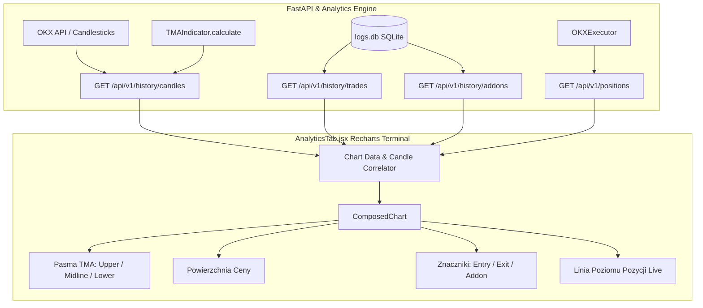

# 📋 PLAN-012: Wykres Ceny i Kanałów TMA z Nakładką Transakcji (Wejścia, Wyjścia, Dokupy)

**Status:** Approved (W trakcie realizacji)  
**Standard:** AGENTS-OS v6.5 Swarm  
**Rola Koordynatora:** Zarządzanie planem, orkiestracja, git worktree  
**Rola Buildera:** Implementacja w `tmp/worktrees/feature/chart-trade-overlays`  
**Target Version:** v0.48.0 (Minor version bump)  

---

## 1. 🎯 Cel i Założenia Projektowe

Użytkownik zażądał nałożenia punktów otwarcia, zamknięcia oraz dokupów (add-on) na wykres ceny i kanału TMA dla poszczególnych par walutowych.

### 🔍 Zidentyfikowane luki w obecnym widoku (`AnalyticsTab.jsx`):
1. **Brak znaczników egzekucji na wykresie:** Operator widzi zamknięte transakcje jedynie w tabeli poniżej wykresu. Brak powiązania punktów wejścia i wyjścia z zachowaniem kanałów TMA w czasie.
2. **Aproksymacja pasm TMA we frontendzie:** Obecnie `AnalyticsTab.jsx` wylicza linie kanału jako prostą aproksymację `c.close * 0.998` oraz `c.high * 1.002`, zamiast używać rzeczywistego algorytmu `TMAIndicator` (TMA + ATR Bands) z silnika analitycznego.
3. **Brak widoczności punktów dokupu (High Risk Add):** Dokupy realizowane przez daemona w stanie `BASE_MODE` nie mają dedykowanej wizualizacji.
4. **Brak wizualizacji aktywnej pozycji na żywo:** Operator nie widzi na wykresie poziomu wejścia aktualnie otwartej pozycji z OKX.

### 🎯 Rezultaty Wdrożenia:
1. **Precyzyjny silnik TMA na backendzie (`/api/v1/history/candles`):** Endpoint wzbogacony o rzeczywiste wartości `tma`, `upper_band`, `lower_band`, `atr` liczone przez `TMAIndicator.calculate()`.
2. **Nakładka Zdarzeń Transakcyjnych na Wykresie (Trade Overlays):**
   - 🟢 **Otwarcie LONG / 🔴 SHORT:** Precyzyjne znaczniki cenowe wejścia w pozycję.
   - 🔷 **Dokup (High Risk Add):** Dedykowany znacznik powiększenia pozycji (`+ADD @ cena`).
   - 🏁 **Zamknięcie pozycji (TP / SL):**
     - Zysk (TP / Midline Close): Zielony punkt z kwotą zysku netto (`+$X.XX`).
     - Strata (Stop-Loss / Emergency): Czerwony znacznik straty (`-$X.XX`).
3. **Linia Aktywnej Pozycji Live:** Pozioma linia `ReferenceLine` z pulsującym badge'em aktualnej ceny wejścia i uPnL dla wybranego symbolu.
4. **HUD Kontrolny Warstw (Layer Toggles):** Możliwość szybkiego włączania/wyłączania warstw (Transakcje, Dokupy, Pasma TMA, Aktywna Pozycja).
5. **Wzbogacony Tooltip Transakcyjny:** Pełne metadane po najechaniu na punkt zlecenia.

---

## 2. 🏗️ Architektura Przepływu Danych

---

## 3. 📝 Zakres Zadań Implementacyjnych (Dla The Builder)

### Faza 1: Backend API (`src/mms4tk/api.py` oraz `logger_db.py`)
1. W `/api/v1/history/candles`:
   - Po pobraniu świec wywołać `TMAIndicator.calculate(candles)` i do każdego obiektu świecy dołączyć: `tma`, `upper_band`, `lower_band`, `atr`.
2. Dodać endpoint `GET /api/v1/history/addons` (lub parametr w `/api/v1/history/trades`):
   - Pobierający historię wykonanych dokupów z `cycle_logs` (`action LIKE '%HIGH_RISK_ADD%'` lub `position_addons`).
3. Zapewnić testy jednostkowe w `tests/test_api.py` potwierdzające obecność pól TMA w odpowiedzi `/api/v1/history/candles`.

### Faza 2: Frontend (`ui_dashboard/src/components/AnalyticsTab.jsx`)
1. **Mapowanie Danych:**
   - Zastąpić sztuczne wyliczenia TMA realnymi wartościami `c.tma`, `c.upper_band`, `c.lower_band` z API.
   - Przypisać transakcje z `tradesHistory` i `openPositions` do odpowiednich świec według timestampów.
2. **Wizualizacja Recharts:**
   - Dodać niestandardowe punkty (`CustomDot` / `Scatter`) dla:
     - `entry_long` (zielony trójkąt w górę `▲`)
     - `entry_short` (czerwony trójkąt w dół `▼`)
     - `addon` (niebiesko-fioletowy romb `◆`)
     - `exit_win` (zielony znacznik z etykietą `+$`)
     - `exit_loss` (czerwony znacznik z etykietą `-$`)
   - Dla aktywnej pozycji z `openPositions`:
     - `ReferenceLine` na osi Y na poziomie `entry_price` z kolorem pozycji (zielony long / czerwony short).
3. **Interaktywny HUD:**
   - Przełączniki warstw: `[x] Zlecenia`, `[x] Dokupy`, `[x] Pasma TMA`, `[x] Aktywna Pozycja`.
   - Tooltip wyświetlający metryki transakcji w punkcie.

### Faza 3: Versioning & Handshake
1. Aktualizacja wersji do `0.48.0` w 5 plikach SSOT:
   - `VERSION`
   - `src/mms4tk/__init__.py`
   - `ui_dashboard/app.py`
   - `ui_dashboard/package.json`
   - `CHANGELOG.md`
2. Wygenerowanie i walidacja Builder Handshake JSON.
3. Testy `pytest` (bez regresji).

---

## 4. 🛡️ Kryteria Akceptacji (Auditor Gate)
- [x] Wszystkie testy `pytest -q -m "not slow"` przechodzą (434 testy passed).
- [x] Endpoint `/api/v1/history/candles` zwraca pola `tma`, `upper_band`, `lower_band`.
- [x] Build frontendu `npm run build` w `ui_dashboard` przechodzi bez błędów.
- [x] Wykres w `AnalyticsTab.jsx` poprawnie renderuje punkty wejścia, wyjścia, dokupu oraz linię aktywnej pozycji.
- [x] Zachowana zgodność z "High Data Density Hedge-Fund Terminal".
- [x] Handshake Verified: Plan-Alignment and Math-Consistency checked. Ready for Coordinator Push.
- [x] Wdrożone na VPS (`0.48.0`), kontenery zdrowe, live trading aktywny.
