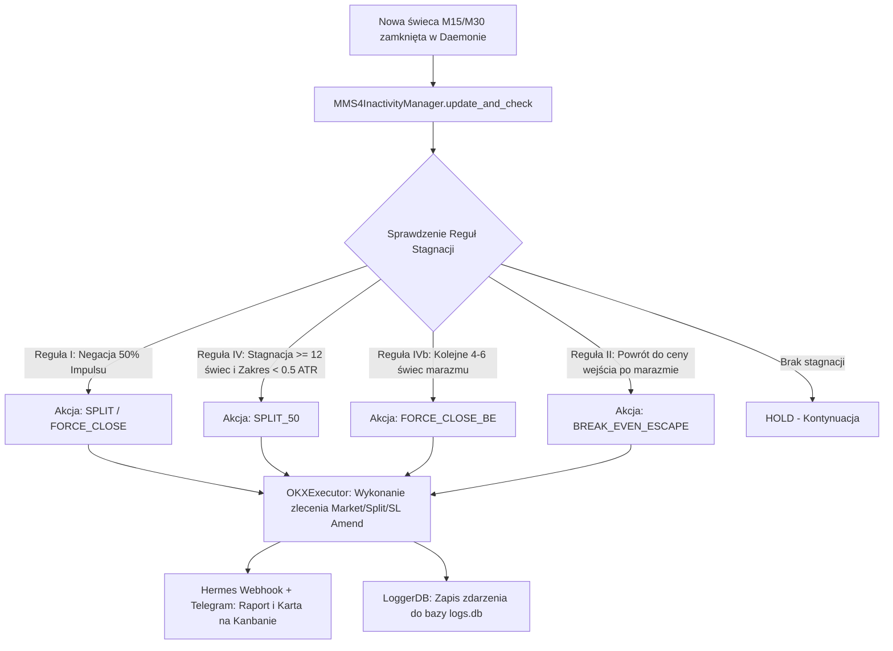

# 📋 PLAN ARCHITEKTONICZNY: MMS4 Stale Position Management & Inactivity Manager (v1.0)

---

## 1. 🎯 CEL PROJEKTU
Wdrożenie do silnika `mms4tk` mechanizmu aktywnego zarządzania pozycjami stagnacyjnymi („kiszącymi się”) według wytycznych wiedzy eksperckiej MMS4 (`.agents/specs/knowledge/mms4-stale-positions-report.md`). Moduł automatycznie chroni kapitał przed kosztami finansowania (Funding Rates) oraz manipulacyjnymi wycięciami Stop Loss (*liquidity sweeps*) w płytkich strefach konsolidacji.

---

## 2. 🧱 ARCHITEKTURA I PRZEPŁYW DANYCH

---

## 3. 🧩 KOMPONENTY I ETAPY IMPLEMENTACJI

### Faza 1: Silnik Analityczny i Manager Stagnacji (`src/mms4tk/inactivity_manager.py`)
- [ ] Klasa `MMS4InactivityManager` śledząca aktywne bilety pozycji:
  - `entry_price`, `entry_time`, `side`, `atr`, `candle_count`.
  - `max_observed_price` (dla Long) i `min_observed_price` (dla Short).
  - Flagi stanu: `is_split`, `stale_detected_at_candle`.
- [ ] Implementacja 4 reguł MMS4:
  1. **Negacja 50% wzniesienia**: jeśli zysk wynosił $> 0.3 \times \text{ATR}$ i cofnął się o $> 50\%$.
  2. **Dekompresja czasu (Split 50%)**: po osiągnięciu progu `max_stale_candles` (domyślnie 12 świec) i odchyleniu $< \text{vol\_compression\_threshold} \times \text{ATR}$ (domyślnie 0.5 ATR).
  3. **Break-Even Escape**: ewakuacja na zero/minimalnej stracie przy powrocie do bazy.
  4. **Dwuetapowa drabinka**: pełne zamknięcie z rynku po kolejnych 4–6 świecach braku reakcji po splicie.

### Faza 2: Integracja z `OKXExecutor` i `daemon.py`
- [ ] `OKXExecutor.split_position(symbol, reduction_pct=0.50)`:
  - Zamyka 50% kontraktów pozycji po cenie rynkowej.
  - Modyfikuje powiązany Stop Loss (`amend_algo_order` / `place_algo_order`) dociągając go pod lokalne knoty lub zmniejszając dystans ryzyka o połowę.
- [ ] Integracja w pętli `MMS4Daemon.run_cycle()`: wywołanie `inactivity_manager.update_and_check()` przy każdym zamknięciu świecy interwału wykonawczego.

### Faza 3: Integracja z Hermes Agent (Autonomia + Kanban + Telegram)
- [ ] Wysyłanie zdarzenia webhooka `STALE_POSITION_SPLIT` / `STALE_POSITION_EXIT` do Hermesa.
- [ ] Hermes tworzy kartę na Kanbanie z pełną analizą przyczynową:
  - Czas trwania pozycji (liczba świec / godziny).
  - Skompresowany zakres zmienności (wartość ATR).
  - Podjęta akcja protekcyjna i uwolniony kapitał.
- [ ] Natychmiastowy dedykowany alert na Telegramie w ramach modułu raportowania.

### Faza 4: Rozszerzenie UI Dashboardu (`SymbolsTab.jsx` & `MonitoringTab.jsx`)
- [ ] Dodanie parametrów konfiguracyjnych per-symbol w formularzu edycji symbolu:
  - `stale_candles_threshold`: Maksymalna liczba świec stagnacji (np. 12 dla BTC, 8 dla SOL).
  - `stale_atr_threshold`: Maksymalny zakres zmienności (np. 0.5 ATR).
  - `impulse_negation_enabled`: Włącznik reguły 50% zniesienia.
- [ ] Status kafelka pozycji w UI: Dodanie wskaźnika świec marazmu (np. `Świece: 7/12 🟢` lub `Kiszenie: 12/12 🟡 SPLIT`).

---

## 4. 🛡️ ZAPEWNIENIE JAKOŚCI I TESTY
1. **Unit testy**: Testy jednostkowe `test_inactivity_manager.py` sprawdzające zachowanie na danych syntetycznych (12 świec bocznych, impuls 50%, powrót BE).
2. **Dry-Run / Live Test na VPS**: Test symulacyjny na serwerze z podglądem logów `antigravity_core` i karty Kanban w Hermesie.
3. **Wersjonowanie**: Podbicie wersji aplikacji zgodnie z regułą SemVer (`MINOR` +0.1.0).
