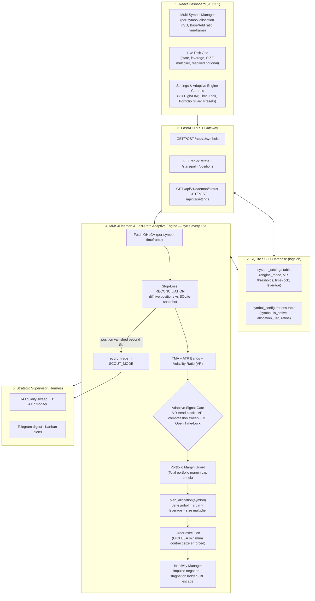

# 🤖 mms4tk — MMS v4 Autotrading Engine & Hermes Agent Swarm

[](https://www.python.org/downloads/)
[](https://fastapi.tiangolo.com/)
[](ui_dashboard/src/App.jsx)
[](https://github.com/ccxt/ccxt)
[](.agents/rules/GOVERNANCE.md)
[](VERSION)
[](docs/AUDIT_MMS4_2026-08-16.md)
[](LICENSE)

**mms4tk** is a multi-symbol adaptive algorithmic trading system for **OKX Europe (EEA) X-Perps /
Expiry Perps & Perpetual Swaps** (BTC/USDC, ETH/USDC, XAU/USDC, XAG/USDC) and Spot markets. It
combines an asynchronous execution daemon (`mms4tk`), a Traefik-secured React dashboard
(`ui_dashboard`), and an autonomous LLM strategic supervisor
([Hermes Agent](https://hermes-agent.nousresearch.com/)).

All runtime strategy, risk parameters, and symbol allocations are persisted directly in SQLite
(`logs.db`), guaranteeing immunity against container rebuilds and `.env` clobbering. The execution
engine dynamically computes the Volatility Ratio ($VR$) to filter out high-risk addons during violent
breakout expansions, mandates Sweep Rejection wicks during compression, blocks shorting during the US
Open institutional liquidity window (13:30–14:30 UTC), and caps total portfolio margin with
interactive 1-click presets (`MAX OKX`, `SUMA PAR`).

---

## 🚦 Current Development Status (v0.47.3, 2026-09-15)

**Live on production** (OKX X-Perp, `BTC/USDC`, `ETH/USDC`, `XAU/USDC`, `XAG/USDC`). Dedicated Telegram notification routing active via `@MMS4_masterek_bot`. See `docs/TELEGRAM_AND_NOTIFICATIONS.md`, `task.md` for the chronological decision log, and `CHANGELOG.md` for per-version release notes.

| Area | Status |
|---|---|
| Authoritative Fill Price & PnL Reconciliation | **Shipped (v0.47.2)** — Precyzyjny odczyt rzeczywistej ceny wykonania (`avgPx`), PnL i prowizji z historii zleceń OKX (`fetch_last_closing_order`). 100% poprawna klasyfikacja `STOP-LOSS`, eliminacja błędu tickera i rozjazdu kwot na Telegramie względem UI. |
| Telegram Notifications & Triad Bot Routing | **Shipped (v0.47.1)** — Dedykowany routing powiadomień `daemon.py` → `TelegramQueueManager` do bota Masterek (`@MMS4_masterek_bot`), izolacja profili Hermes. Zobacz [`docs/TELEGRAM_AND_NOTIFICATIONS.md`](docs/TELEGRAM_AND_NOTIFICATIONS.md). |
| Silver (XAG) Support & Commodity Expansion | **Shipped (v0.47.0)** — OKX EEA X-Perp discovery (`XAG-USD_UM_XPERP-310509`), 0.01 XAG contract sizing, $100 allocation. |
| Gold (XAU) Support & Commodity Expansion | **Shipped (v0.46.0)** — OKX EEA X-Perp discovery (`XAU-USD_UM_XPERP-310502`), 0.001 XAU contract sizing, $100 allocation. |
| Inactivity Manager: Live Price Feed & Giveback Protection | **Shipped (v0.45.1, PR #60)** — intra-candle price feed via `candles[-1].close`, fast reversal guard (`peak >= 1.0` ATR, >50% giveback -> `SPLIT_50`). |
| Core engine, SSOT, Portfolio Margin Guard, Midline TP | Stable, in production |
| P3 V2 stop-loss SSOT (base-entry-pinned SL, no separate addon SL) | Shipped, production default |
| SCOUT_MODE risk reduction (position size, not leverage) | Shipped, production default |
| Backtest harness ↔ production parity (`addon_sl_variant="V2"` default) | Fixed (was silently defaulting to pre-P3 `"V0"`) |
| H4 directional-bias gate (`htf_directional_gate_enabled`) | Implemented, **default OFF** — strongest measured signal to date (10/10 independent windows improved, sign test p=0.0020), reduces trend-regime losses ~25-30% without making the strategy net-profitable. Enabling it per symbol is a deliberate operational decision. |
| Rolling TMA/ATR recalibration (7-14d) | Measured and **rejected** — apparent gains are in-sample selection bias (chi-square test confirms parameter choice is statistically indistinguishable from random) |
| D1 ATR exhaustion filter (blocks `HIGH_RISK_ADD`) | Measured and **rejected** — the 2.5×ATR_D1 trigger almost never fires even in strong trends, zero measurable effect across 16 independent windows |


**Known limitation, not a bug**: this is a mean-reversion strategy, structurally vulnerable to
sustained trends. A 24-month backtest (`task.md`, "Faza 2") found a median independent-window net
result of ≈ −23%, with the single worst window matching a real, well-documented +64% BTC rally. The
H4 directional gate above is the most promising lever measured so far against this limitation.

---

## 🏛️ System Architecture



---

## 🛡️ Risk Model & Adaptive Tactics

### 🗄️ Unified SQLite SSOT (Container Rebuild Immune)

All dynamic parameters are maintained in SQLite on a persistent Docker volume:
- `system_settings`: Stores global trading configurations (engine mode, VR thresholds, session time-locks, default risk profiles).
- `symbol_configurations`: Stores per-symbol allocation budgets, timeframes, and active flags.
- **Immediate Live-Reload**: Changes made in the UI or by Hermes Agent via REST API take effect in real-time in the daemon's active 15s cycle.

### ⚡ Hybrid Adaptive Engine (Fast-Path Supervision)

Operating in two switchable modes (`MMS4_ENGINE_MODE`):
- `CLASSIC`: Standard MMS v4 mean-reversion rules.
- `ADAPTIVE`: Fast-path supervision using mathematical volatility and session filters:

1. **Volatility Ratio ($VR$)**:
   $$\text{VR} = \frac{\text{ATR}(14)}{\text{SMA}(\text{ATR}(100), 14) + \epsilon}, \quad \epsilon = 10^{-8}$$
   - **High Volatility Expansion ($VR > \text{adaptive\_vr\_high}$, default `1.0`)**: Blocks `HIGH_RISK_ADD` signals (`SKIPPED_HIGH_VOLATILITY`).
   - **Low Volatility Compression ($VR < \text{adaptive\_vr\_low}$, default `0.75`)**: Blocks base entries without a verified **Sweep Rejection** wick ($\ge 20\%$ of candle range; `SKIPPED_COMPRESSION_NO_SWEEP`).
2. **US Open Session Window Time-Lock**:
   - In UTC window `13:30` - `14:30` (`time_lock_start` - `time_lock_end`), blocks `BASE_SHORT` entries (`SKIPPED_TIME_LOCK`), unless an **Extreme Sweep Rejection** (upper wick $\ge 40\%$) is present.

### 🛡️ Portfolio Margin Guard (Circuit Breaker & Quick Presets)

- `total_max_portfolio_margin_usd`: Global ceiling on total committed position margin across **all symbols combined**.
- When $> 0$, the daemon evaluates $\sum \text{Margin}_{\text{open}} + \text{Margin}_{\text{candidate}} \le \text{Cap} \times 1.05$. If exceeded, new entries are blocked (`PORTFOLIO_GUARD_BLOCKED_*`).
- **1-Click Presets in Dashboard**:
  - `[MAX OKX]`: Fills 100% of live available margin from OKX API (`free_balance`, e.g. ~$323 USDC).
  - `[SUMA PAR]`: Calculates sum of active symbol allocations ($\sum \text{allocation\_usd}$, e.g. $60 USD).
  - `[Wyłącz (0)]`: Clears the cap to disable portfolio-level blocking.


### Capital allocation — relational, not hardcoded

Every figure derives from `MMS4_MAX_MARGIN_USD`, so the same code serves a $10 forward test and a
$1000 live allocation:

```
margin_base   = max_margin_usd × BASE_ALLOCATION  (0.70) × size_multiplier
margin_addon  = max_margin_usd × ADDON_ALLOCATION (0.30) × size_multiplier
notional      = margin × leverage
```

| Mode | Leverage | Size multiplier | Base notional @ $10 cap | vs BASE |
|---|---|---|---|---|
| `BASE_MODE` (MODERATE) | 3.0x | 1.00 | $21.00 | — |
| `SCOUT_MODE` | 1.0x | 0.30 | $2.10 | **10× smaller** |

The reduction factor is `base_leverage / (SCOUT_LEVERAGE × SCOUT_SIZE_MULT)` — independent of
account size.

### Position lifecycle protection

| Rule | Trigger | Action |
|---|---|---|
| Impulse negation | impulse > `impulse_min_atr` × ATR, then >50% retracement | `SPLIT_50`, then `FORCE_CLOSE` — latched, one action per candle |
| Stagnation ladder | price within 0.5×ATR of entry for `stale_candles_threshold` candles | `SPLIT_50` → `FORCE_CLOSE_BE` after grace |
| Break-even escape | price back at entry after stagnation | `BE_ESCAPE` (optional round-trip cost allowance) |
| Single Addon Guard | one high-risk add per position | persisted in SQLite, survives restarts |
| Portfolio Margin Guard | total open portfolio notional > cap | blocks new base/addon order creation |
| Adaptive VR Gate | $VR > 1.6$ (trend) or $VR < 0.8$ (compression) | blocks addon in trend / requires sweep wick in compression |
| US Open Time-Lock | $13:30 - 14:30$ UTC window | blocks shorting unless extreme sweep wick $\ge 40\%$ |
| Take Profit & Flip | opposite TMA band reached | verified close, then flip — aborts if the close is unconfirmed |

---

## ⚙️ Configuration

Create `.env` in the project root (or `/docker/mms4tk/.env` on the VPS). Full reference with
comments lives in [`.env.example`](.env.example).

```ini
# OKX API Credentials (R-SEC-01: secrets never leave .env)
OKX_API_KEY=your_okx_api_key
OKX_SECRET=your_okx_api_secret
OKX_PASSPHRASE=your_okx_passphrase

# Capital & Position Sizing
MMS4_SYMBOL=BTC/USDC
MMS4_MAX_MARGIN_USD=10.0
MMS4_BASE_ALLOCATION=0.70
MMS4_ADDON_ALLOCATION=0.30

# SCOUT_MODE — risk cut by size, leverage stays exchange-legal
MMS4_SCOUT_LEVERAGE=1.0
MMS4_SCOUT_SIZE_MULT=0.3

# BASE_MODE leverage per risk profile (set MODERATE=1.0 for the literal MMS v4 spec)
MMS4_LEVERAGE_CONSERVATIVE=1.0
MMS4_LEVERAGE_MODERATE=3.0
MMS4_LEVERAGE_AGGRESSIVE=10.0

# Stop-loss distances (entries + reconciliation threshold)
MMS4_BASE_SL_PCT=0.02
MMS4_ADDON_SL_PCT=0.0125

# Portfolio Margin Guard (0 = disabled)
MMS4_TOTAL_MAX_PORTFOLIO_MARGIN_USD=0

# Adaptive Hybrid Engine (CLASSIC | ADAPTIVE)
MMS4_ENGINE_MODE=CLASSIC
MMS4_ADAPTIVE_VR_HIGH=1.6
MMS4_ADAPTIVE_VR_LOW=0.8
MMS4_TIME_LOCK_START=13:30
MMS4_TIME_LOCK_END=14:30

# Indicators
MMS4_ATR_METHOD=sma          # "wilder" aligns with TradingView; also retune atr_mult
MMS4_MIN_NOTIONAL_USD=7.0    # fallback only — real minimum comes from CCXT

# Security & Hermes
MMS4_API_KEY=your_secret_mms4tk_api_key
MMS4_UI_BASIC_AUTH=admin:{SHA}...
HERMES_API_BASE=http://hermes-agent:8300
```

---

## 🚀 Quickstart

**Requirements:** Python 3.11+, Node.js 18+, Docker & Docker Compose.

```bash
git clone https://github.com/tkogut/mms4tk.git
cd mms4tk
pip install -r requirements.txt

# Core FastAPI daemon
PYTHONPATH=src python3 -m uvicorn mms4tk.api:app --host 0.0.0.0 --port 8000 --reload
```

```bash
# React dashboard
cd ui_dashboard
npm install          # required locally; Docker installs it during the image build
npm run dev
```

---

## 🧪 Testing

```bash
# Unit + regression suite (one test per audit finding)
python3 -m pytest tests/ -q

# Executable audit scripts — 61 assertions, mocks only, no exchange calls
for f in tests/audit/audit_*.py; do python3 "$f"; done
```

The audit scripts are deliberately runnable **inside the production container**, which is how each
release is verified:

```bash
docker exec antigravity_core sh -c 'cd /app/tests/audit && for f in audit_*.py; do python3 "$f"; done'
```

Convention: **FAIL means the defect is present** — assertions state the desired property.

---

## 🐳 Deployment

```bash
cd /docker/mms4tk
git pull origin main
docker compose up -d --build antigravity_core ui_dashboard
```

Post-deploy verification:

```bash
# Version
docker exec antigravity_core python3 -c "import urllib.request,json; \
  print(json.load(urllib.request.urlopen('http://localhost:8000/api/v1/health'))['version'])"

# Source parity between repo and container
md5sum src/mms4tk/daemon.py
docker exec antigravity_core md5sum /app/src/mms4tk/daemon.py

# Resolved sizing per symbol
curl -s localhost:8000/api/v1/daemon/status | jq '.allocation_plan'
```

---

## 📚 Documentation

| Document | Contents |
|---|---|
| [Quantitative audit 2026-08-16](docs/AUDIT_MMS4_2026-08-16.md) | 33 findings (2×P0, 11×P1, 20×P2) with evidence and remediation status |
| [Refactoring report](docs/REFACTORING_REPORT_2026-08-16.md) | What changed, why, and what it cost — before/after per module |
| [Configuration recommendations](docs/REKOMENDACJE_KONFIGURACJA_2026-08-16.md) | Leverage, BE cost allowance, ATR smoothing — measured trade-offs |
| [MMS v4 strategy & architecture](docs/mms4_mastermind_full_strategy_and_architecture.md) | Strategy specification |
| [REST API](docs/API.md) | Endpoint reference |
| [Deployment guide](docs/DEPLOYMENT_GUIDE.md) | VPS / Docker / Traefik |
| [Audit scripts](tests/audit/README.md) | How to run the 61 verification assertions |
| [Code review guide](CODE_REVIEW.md) | Repo-specific review priorities, checks, and severity guidance — auto-applied by `om-code-review` |
| [Backward compatibility](BACKWARD_COMPATIBILITY.md) | Protected contract surfaces (API, DB schema, env vars, Hermes tool schemas) and the required path to change them |

---

## 📜 Governance & License

Developed under **AGENTS-OS v6.5 Swarm Edition** protocols (worktree → handshake → QA gate → merge).
Released under the [MIT License](LICENSE).
