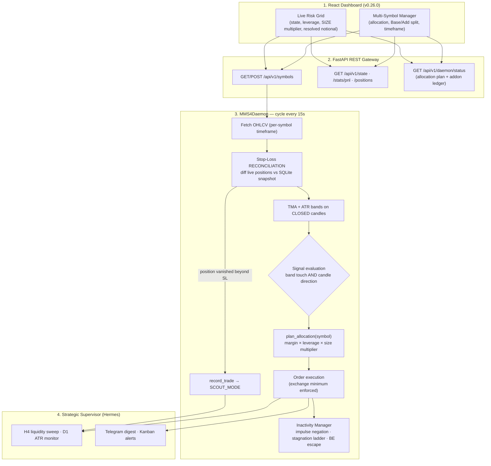

# 🤖 mms4tk — MMS v4 Autotrading Engine & Hermes Agent Swarm

[](https://www.python.org/downloads/)
[](https://fastapi.tiangolo.com/)
[](ui_dashboard/src/App.jsx)
[](https://github.com/ccxt/ccxt)
[](.agents/rules/GOVERNANCE.md)
[](VERSION)
[](docs/AUDIT_MMS4_2026-08-16.md)
[](LICENSE)

**mms4tk** is a multi-symbol adaptive algorithmic trading system for **OKX Europe (EEA) X-Perps /
Expiry Perps & Perpetual Swaps** (BTC/USDC, ETH/USDC, SOL/USDC, ICP/USDC) and Spot markets. It
combines an asynchronous execution daemon (`mms4tk`), a Traefik-secured React dashboard
(`ui_dashboard`), and an autonomous LLM strategic supervisor
([Hermes Agent](https://hermes-agent.nousresearch.com/)).

> **v0.26.0 is a risk-engine release.** A full quantitative audit
> ([report](docs/AUDIT_MMS4_2026-08-16.md)) found that the defensive layer described in earlier
> versions of this README was not actually reachable in running code. It is now implemented,
> tested and verified in production. The sections below describe what the system *does*, not what
> it was intended to do — see [Refactoring report](docs/REFACTORING_REPORT_2026-08-16.md) for the
> before/after.

---

## 🏛️ System Architecture



---

## 🛡️ Risk Model

### Capital allocation — relational, not hardcoded

Every figure derives from `MMS4_MAX_MARGIN_USD`, so the same code serves a $10 forward test and a
$1000 live allocation:

```
margin_base   = max_margin_usd × BASE_ALLOCATION  (0.70) × size_multiplier
margin_addon  = max_margin_usd × ADDON_ALLOCATION (0.30) × size_multiplier
notional      = margin × leverage
```

| Mode | Leverage | Size multiplier | Base notional @ $10 cap | vs BASE |
|---|---|---|---|---|
| `BASE_MODE` (MODERATE) | 3.0x | 1.00 | $21.00 | — |
| `SCOUT_MODE` | 1.0x | 0.30 | $2.10 | **10× smaller** |

The reduction factor is `base_leverage / (SCOUT_LEVERAGE × SCOUT_SIZE_MULT)` — independent of
account size.

### Why SCOUT reduces SIZE and not leverage

OKX only accepts integer leverage `>= 1`. A sub-1x setting is silently clamped to 1x on the
exchange, so leverage cannot express a defensive reduction at all. Worse, the notional it implied
fell below the venue's minimum order value, the entry was skipped, no position opened, no
take-profit could fire — and the symbol could never leave `SCOUT_MODE`. Risk is therefore cut
through position **size**, with leverage kept exchange-legal.

### State machine

- `BASE_MODE → SCOUT_MODE` — a stop-out of `>= 2%`, detected by **reconciliation**: the daemon
  compares live OKX positions against a SQLite snapshot each cycle and books the trade the moment
  a position disappears beyond the SL distance. Snapshots persist, so this survives a restart.
- `SCOUT_MODE → BASE_MODE` — first take-profit on that symbol, or a manual release
  (`POST /api/v1/settings/update {"scout_mode": false}`), or Hermes `scout_override`.
- State is **per symbol**. A stop-out on BTC does not touch ETH.

### Exchange minimums

Read per instrument from CCXT market metadata (`limits.cost.min`, or smallest lot × price) — not a
fixed dollar figure. Measured on OKX X-Perps: BTC $6.30, ETH $1.88, SOL $0.75, ICP $2.28. When the
intended size falls below the venue minimum the entry is **skipped** (`SKIPPED_*` outcome), never
inflated to meet it.

> At the $10 forward-testing cap, `SCOUT_MODE` can trade ETH and SOL but not BTC or ICP. All four
> clear at `MMS4_MAX_MARGIN_USD >= ~$30` — the exact threshold is
> `min_notional / (BASE_ALLOCATION × SCOUT_SIZE_MULT × SCOUT_LEVERAGE)` and moves with the price of
> the most expensive contract (BTC at the time of writing).

### Position lifecycle protection

| Rule | Trigger | Action |
|---|---|---|
| Impulse negation | impulse > `impulse_min_atr` × ATR, then >50% retracement | `SPLIT_50`, then `FORCE_CLOSE` — latched, one action per candle |
| Stagnation ladder | price within 0.5×ATR of entry for `stale_candles_threshold` candles | `SPLIT_50` → `FORCE_CLOSE_BE` after grace |
| Break-even escape | price back at entry after stagnation | `BE_ESCAPE` (optional round-trip cost allowance) |
| Single Addon Guard | one high-risk add per position | persisted in SQLite, survives restarts |
| Take Profit & Flip | opposite TMA band reached | verified close, then flip — aborts if the close is unconfirmed |

---

## ⚙️ Configuration

Create `.env` in the project root (or `/docker/mms4tk/.env` on the VPS). Full reference with
comments lives in [`.env.example`](.env.example).

```ini
# OKX API Credentials (R-SEC-01: secrets never leave .env)
OKX_API_KEY=your_okx_api_key
OKX_SECRET=your_okx_api_secret
OKX_PASSPHRASE=your_okx_passphrase

# Capital
MMS4_SYMBOL=BTC/USDC
MMS4_MAX_MARGIN_USD=10.0
MMS4_BASE_ALLOCATION=0.70
MMS4_ADDON_ALLOCATION=0.30

# SCOUT_MODE — risk cut by size, leverage stays exchange-legal
MMS4_SCOUT_LEVERAGE=1.0
MMS4_SCOUT_SIZE_MULT=0.3

# BASE_MODE leverage per risk profile (set MODERATE=1.0 for the literal MMS v4 spec)
MMS4_LEVERAGE_CONSERVATIVE=1.0
MMS4_LEVERAGE_MODERATE=3.0
MMS4_LEVERAGE_AGGRESSIVE=10.0

# Stop-loss distances (entries + reconciliation threshold)
MMS4_BASE_SL_PCT=0.02
MMS4_ADDON_SL_PCT=0.0125

# Indicators
MMS4_ATR_METHOD=sma          # "wilder" aligns with TradingView; also retune atr_mult
MMS4_MIN_NOTIONAL_USD=7.0    # fallback only — real minimum comes from CCXT

# Security & Hermes
MMS4_API_KEY=your_secret_mms4tk_api_key
MMS4_UI_BASIC_AUTH=admin:{SHA}...
HERMES_API_BASE=http://hermes-agent:8300
```

---

## 🚀 Quickstart

**Requirements:** Python 3.11+, Node.js 18+, Docker & Docker Compose.

```bash
git clone https://github.com/tkogut/mms4tk.git
cd mms4tk
pip install -r requirements.txt

# Core FastAPI daemon
PYTHONPATH=src python3 -m uvicorn mms4tk.api:app --host 0.0.0.0 --port 8000 --reload
```

```bash
# React dashboard
cd ui_dashboard
npm install          # required locally; Docker installs it during the image build
npm run dev
```

---

## 🧪 Testing

```bash
# Unit + regression suite (one test per audit finding)
python3 -m pytest tests/ -q

# Executable audit scripts — 61 assertions, mocks only, no exchange calls
for f in tests/audit/audit_*.py; do python3 "$f"; done
```

The audit scripts are deliberately runnable **inside the production container**, which is how each
release is verified:

```bash
docker exec antigravity_core sh -c 'cd /app/tests/audit && for f in audit_*.py; do python3 "$f"; done'
```

Convention: **FAIL means the defect is present** — assertions state the desired property.

---

## 🐳 Deployment

```bash
cd /docker/mms4tk
git pull origin main
docker compose up -d --build antigravity_core ui_dashboard
```

Post-deploy verification:

```bash
# Version
docker exec antigravity_core python3 -c "import urllib.request,json; \
  print(json.load(urllib.request.urlopen('http://localhost:8000/api/v1/health'))['version'])"

# Source parity between repo and container
md5sum src/mms4tk/daemon.py
docker exec antigravity_core md5sum /app/src/mms4tk/daemon.py

# Resolved sizing per symbol
curl -s localhost:8000/api/v1/daemon/status | jq '.allocation_plan'
```

---

## 📚 Documentation

| Document | Contents |
|---|---|
| [Quantitative audit 2026-08-16](docs/AUDIT_MMS4_2026-08-16.md) | 33 findings (2×P0, 11×P1, 20×P2) with evidence and remediation status |
| [Refactoring report](docs/REFACTORING_REPORT_2026-08-16.md) | What changed, why, and what it cost — before/after per module |
| [Configuration recommendations](docs/REKOMENDACJE_KONFIGURACJA_2026-08-16.md) | Leverage, BE cost allowance, ATR smoothing — measured trade-offs |
| [MMS v4 strategy & architecture](docs/mms4_mastermind_full_strategy_and_architecture.md) | Strategy specification |
| [REST API](docs/API.md) | Endpoint reference |
| [Deployment guide](docs/DEPLOYMENT_GUIDE.md) | VPS / Docker / Traefik |
| [Audit scripts](tests/audit/README.md) | How to run the 61 verification assertions |

---

## 📜 Governance & License

Developed under **AGENTS-OS v6.5 Swarm Edition** protocols (worktree → handshake → QA gate → merge).
Released under the [MIT License](LICENSE).
