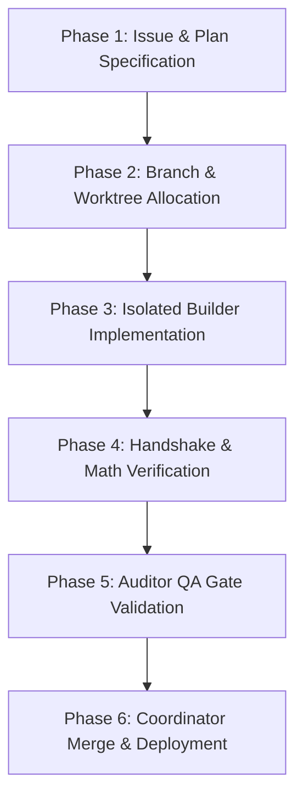

# 🔄 SDLC Lifecycle Standard (v6.5 Swarm Edition)

**Status:** Single Source of Truth for Software Development Life Cycle  
**Governance Model:** AGENTS-OS v6.5 Swarm Triad (Coordinator, Builder, Auditor)

---

## 📌 The 6-Phase Execution Pipeline

Every code change, bugfix, or feature addition in `mms4tk` strictly adheres to the following 6-phase lifecycle:

---

### Phase 1: Issue & Plan Specification
- Every task must begin with a clear goal statement or structured plan in `.agents/plans/` or tracker issue.
- The **Coordinator** assigns roles and validates architectural boundaries before execution.

### Phase 2: Branch & Worktree Allocation
- **Isolated Workspace**: Feature work is forbidden directly on `main`.
- All development takes place in a fresh Git Worktree created via `./os-run-builder <task_name>` in `tmp/worktrees/task_<name>/`.

### Phase 3: Isolated Builder Implementation
- The **Builder** role operates strictly inside the isolated worktree directory.
- Edits are limited to feature files, unit tests, and source modules.
- Under Swarm Triad rules, commits must set `SWARM_ROLE=builder`.

### Phase 4: Handshake & Math Verification
- Prior to completion, code must pass full unit test suites (`pytest`).
- **Documentation Consistency (added 2026-09-12, after a large retroactive
  docs/knowledge cleanup)**: if this change is one of the following, update
  the matching doc(s) in the SAME PR — not as a later follow-up:
  - Changes a production default or adds/toggles a feature flag → `task.md`
    (decision + evidence) and, if user-facing, `README.md`'s "Current
    Development Status".
  - Adds, removes, or moves a documentation/plan/spec file → the file(s)
    that link to it (`README.md`'s Documentation table, `.agents/MEMORY.md`,
    any hardcoded path elsewhere — grep before assuming nothing points to it).
  - Bumps `VERSION` → `CHANGELOG.md` entry (already mandatory per
    `.agents/MEMORY.md`'s SSOT 4-file sync rule; restated here as a Handshake
    gate, not just a convention).
  A trivial fix/refactor with no behavior, default, or file-topology change
  needs none of this — don't turn every commit into a documentation exercise.
- Output statement:
  > "Handshake Verified: Plan-Alignment, Math-Consistency, and Documentation-Consistency checked. Ready for Coordinator Push."

### Phase 5: Auditor QA Gate Validation
- The **Auditor** verifies that:
  1. No secret leaks or unauthenticated mutating endpoints exist.
  2. All validation gates defined in `.ai/agentic.config.json` pass (`52/52 PASSED`).
  3. Pre-commit role hooks are respected.
  4. **Documentation Consistency** (Phase 4's rule was actually followed): if
     the diff matches one of the trigger conditions above, the corresponding
     doc file is ALSO in the diff. A production-behavior or file-topology
     change with no doc update is grounds to block the merge and send it back
     to the Builder — the same standing this session gave to a missing test.
     No automated check yet (a `VERSION`↔`CHANGELOG.md` bump-matcher script
     would be the natural next step) — this is a manual review gate for now,
     same as 1-3 above.

### Phase 6: Coordinator Merge & Deployment
- The **Coordinator** merges the worktree branch into `main` using `--no-ff`.
- The worktree is cleaned up via `git worktree remove`.
- Code is pushed to `origin/main` and deployed to VPS (`srv1490214.hstgr.cloud`).
