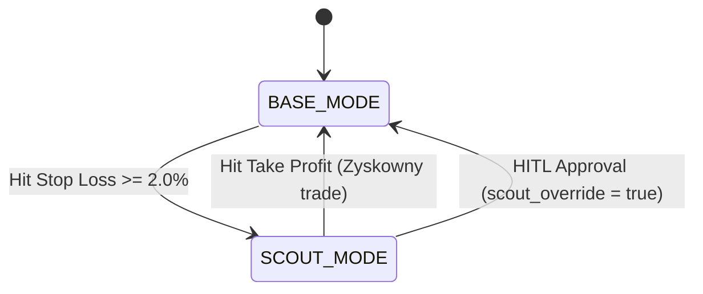

# 📘 Strategia Handlowa MMS v4 (MastermindZX)

**Wersja Specyfikacji:** 4.0.0  
**Giełda Docelowa:** OKX Perpetual Swaps (np. `BTC/USDC`, `ETH/USDC`)  
**Architektura Systemu:** Dwupoziomowy Automat Adaptacyjny (Silnik M15 `mms4tk` + Nadzorca H4/D1 `Hermes Agent`)

---

## 🏛️ Diagram Architektury Decyzyjnej

```mermaid
graph TD
    subgraph 1. Taktyczna Warstwa Wykonawcza (M15 - mms4tk)
        CANDLES[Utwardzone Świece M15 closed] --> IND[Wyliczenie TMA_M15 i ATR_M15]
        IND --> EVAL{Ewaluacja Sygnału M15}
        
        EVAL -->|Cena dotyka dolnej wstęgi + Zamknięcie w górę| LONG[Otwórz BASE_LONG - 70% Limit Kapitału]
        EVAL -->|Cena dotyka górnej wstęgi + Zamknięcie w dół| SHORT[Otwórz BASE_SHORT - 70% Limit Kapitału]
        EVAL -->|Cena wewnątrz pasma / Brak reakcji| IDLE[Brak Akcji / Czekaj 15s]
        
        LONG --> SL_CHECK{Status Otwartych Pozycji}
        SHORT --> SL_CHECK
        
        SL_CHECK -->|Hit SL >= 2.0%| SCOUT[SCOUT_MODE: Redukcja Lewaru do 0.1x]
        SL_CHECK -->|Hit TP| BASE_OK[BASE_MODE: Przywrócenie Lewaru 1.0x]
        
        SCOUT --> WB_EMIT[Emisja Webhook SCOUT_MODE_ACTIVATED]
    end

    subgraph 2. Strategiczna Warstwa Nadzorcza (H4/D1 - Hermes Agent)
        WB_EMIT --> DISPATCH[Event Dispatcher - Cron 1 min]
        DISPATCH --> KANBAN[(Hermes Kanban.db)]
        
        CRON_H4[Cron H4 Analysis - co 4h] --> H4_EVAL{Ocena Świecy H4}
        H4_EVAL -->|Knot Sweep / Reversal| RELAX[Złagodzenie SCOUT_MODE scout_override=true]
        H4_EVAL -->|Marubozu Breakout| STRICT[Utrzymanie SCOUT_MODE x0.1]
        H4_EVAL -->|Niejednoznaczny Sweep| HITL_BLOCK[Karta BLOCKED w Kanbanie]
        
        CRON_D1[Cron D1 ATR Check - 00:05 UTC] --> D1_EVAL{Rozszerzenie ATR_D1}
        D1_EVAL -->|> 2.5x ATR_D1| RISK_DOWN[Profil Ryzyka = CONSERVATIVE]
    end

    subgraph 3. Interfejs Decyzyjny & Telegram Push (HITL & Dokupienie)
        HITL_BLOCK --> NOTIFY[Powiadomienie Push na Telegram]
        NOTIFY --> USER((Użytkownik Tomasz))
        USER -->|Rozstrzygnięcie na Telegramie / Web UI| RESOLVE[POST /api/v1/hermes/hitl_resolve]
        USER -->|Zatwierdzenie Dokupienia| ADDON[POST /api/v1/trade/high_risk_add - 30% Limit Kapitału]
        RESOLVE --> StateMgr[MMS4StateManager]
        ADDON --> StateMgr
    end
```

---

## 💰 1. Model Alokacji Kapitałowej (70/30 Capital Split)

Aby zapewnić sztywną ochronę depozytu i wyeliminować ryzyko przekroczenia założonego budżetu, system stosuje **sztywny limit zaangażowania (Max Total Margin Cap)**:

- **Zmienna Środowiskowa**: `MMS4_MAX_MARGIN_USD` (np. **`10.0 USD`**).
- **Pozycja Bazowa (`BASE_LONG` / `BASE_SHORT`)**:
  - Wykorzystuje **70% całkowitego limitu** = **`7.00 USD`** (przy lewarze 1.0x).
  - Sztywny Stop Loss = **`2.0%`**.
- **Dokupienie Dodatkowe (`HIGH_RISK_ADD`)**:
  - Wykorzystuje **30% całkowitego limitu** = **`3.00 USD`** (przy lewarze 1.0x).
  - Ciasny Stop Loss = **`1.0%`**.
- **Maksymalny Łączny Depozyt na Rynku**: $7.00 + $3.00 = **`10.00 USD`** (nieprzekraczalny limit).
- **Maksymalna Łączna Strata przy SL obu pozycji**:
  $$\text{Max Loss} = (7.00 \times 0.02) + (3.00 \times 0.01) = 0.14 + 0.03 = \mathbf{0.17 \text{ USD}} \quad (17 \text{ centów!})$$

---

## ⚡ 2. Taktyczna Warstwa Wykonawcza (M15 - `mms4tk`)

Silnik wykonawczy działa w 15-sekundowej pętli asynchronicznej i podejmuje decyzje wyłącznie na **utwardzonych (zamkniętych) świecach M15** (`candles[:-1]`), co całkowicie eliminuje zjawisko *look-ahead bias*.

### Wskaźniki i Sygnały M15:
1. **Triangular Moving Average (TMA)**:
   Wygładzona średnia ruchoma wyznaczająca korytarz cenowy (środek, górna wstęga `upper_band`, dolna wstęga `lower_band`).
2. **Average True Range (ATR)**:
   Miarodajny wskaźnik zmienności określający szerokość wstęgi odchylenia.
3. **Logika Sygnałów**:
   - **`BASE_LONG`**: Zamknięta świeca M15 narusza dolną wstęgę `lower_band` i zamyka się świecą wzrostową $\rightarrow$ Otwarcie pozycji za $7.00 USD (SL 2.0%).
   - **`BASE_SHORT`**: Zamknięta świeca M15 narusza górną wstęgę `upper_band` i zamyka się świecą spadkową $\rightarrow$ Otwarcie pozycji za $7.00 USD (SL 2.0%).

---

## 🛡️ 3. Maszyna Stanów i Redukcja Ryzyka (`SCOUT_MODE`)

Strategia MastermindZX kładzie najwyższy priorytet na ochronę kapitału przed kaskadowymi stratami w silnych trendach.



- **`BASE_MODE` (Pełna Ekspozycja)**: Domyślny stan roboczy z lewarem 1.0x i pełną alokacją.
- **`SCOUT_MODE` (Tryb Obronny / Redukcja Risk)**:
  - Aktywowany natychmiast po trafieniu w Stop Loss $\ge 2.0\%$.
  - Redukuje dźwignię **dziesięciokrotnie z 1.0x do 0.1x**.
  - W trybie `SCOUT_MODE` maksymalne ryzyko na pojedynczą pozycję spada do **0.02 USD (2 centy)**.
  - Zablokowana zostaje możliwość dokupywania `HIGH_RISK_ADD`.

---

## 🧠 4. Strategiczna Warstwa Nadzorcza (H4/D1 - Hermes Agent)

Hermes Agent działa jako wyższy analityk, monitorując kontekst rynkowy na wyższych ramach czasowych poprzez automatyczne skrypty Cron:

### A. Analiza H4 (Wybicia vs Wykończenia Knotów):
- **Liquidity Sweep (Knot H4)**: Świeca H4 wybiła poziom, ale zamknęła się długim knotem wewnątrz wstęgi TMA_H4. Hermes rozpoznaje to jako "pułapkę na płynność" i złagodzenie `SCOUT_MODE` (`scout_override = true`).
- **Real Breakout (Marubozu H4)**: Świeca H4 zamyka się pełnym korpusem poza wstęgą. Hermes rygorystycznie utrzymuje `SCOUT_MODE` (0.1x), chroniąc kapitał przed silnym trendem.

### B. Filtr Kierunkowy (`directional_bias`):
- **`LONG_ONLY`**: H4 silnie powyżej środka TMA $\rightarrow$ Zablokowane pozycje SHORT.
- **`SHORT_ONLY`**: H4 silnie poniżej środka TMA $\rightarrow$ Zablokowane pozycje LONG.
- **`BOTH`**: H4 wewnątrz pasma (konsolidacja) $\rightarrow$ Zgoda na handel z obu stron band.

### C. Wyczerpanie ATR na D1 (`overextension`):
- Jeśli dzienny ruch ceny przekroczy $2.5 \times \text{ATR\_D1}$, rynek wszedł w fazę euforii/paniki. Hermes przełącza profil ryzyka na **`CONSERVATIVE`** i blokuje dokupywanie `HIGH_RISK_ADD`.

---

## 📲 5. Human-in-the-Loop (HITL) i Powiadomienia Telegram

Gdy ocena świecy H4 jest niejednoznaczna lub pojawia się okazja na ciasne dokupienie:

1. **Kanban & Dispatcher**: Skrypt `mms4tk_event_dispatcher.py` tworzy kartę w `kanban.db` w stanie `blocked`.
2. **Telegram Push**: Hermes natychmiast wysyła wiadomość push na Telegram użytkownika:
   > 🚨 **MMS4TK ALERT**: H4 Liquidity Sweep Analysis (BTC/USDC SL 2.0%)  
   > *Wykryto knot na H4. Wymagana decyzja:*  
   > - `SWEEP_WICK` (złagodzenie SCOUT_MODE)  
   > - `MARUBOZU_BREAKOUT` (utrzymanie SCOUT_MODE 0.1x)
3. **Rozstrzygnięcie**: Po decyzji użytkownika w Web UI lub na Telegramie, Hermes wywołuje endpoint `POST /api/v1/hermes/hitl_resolve`.
