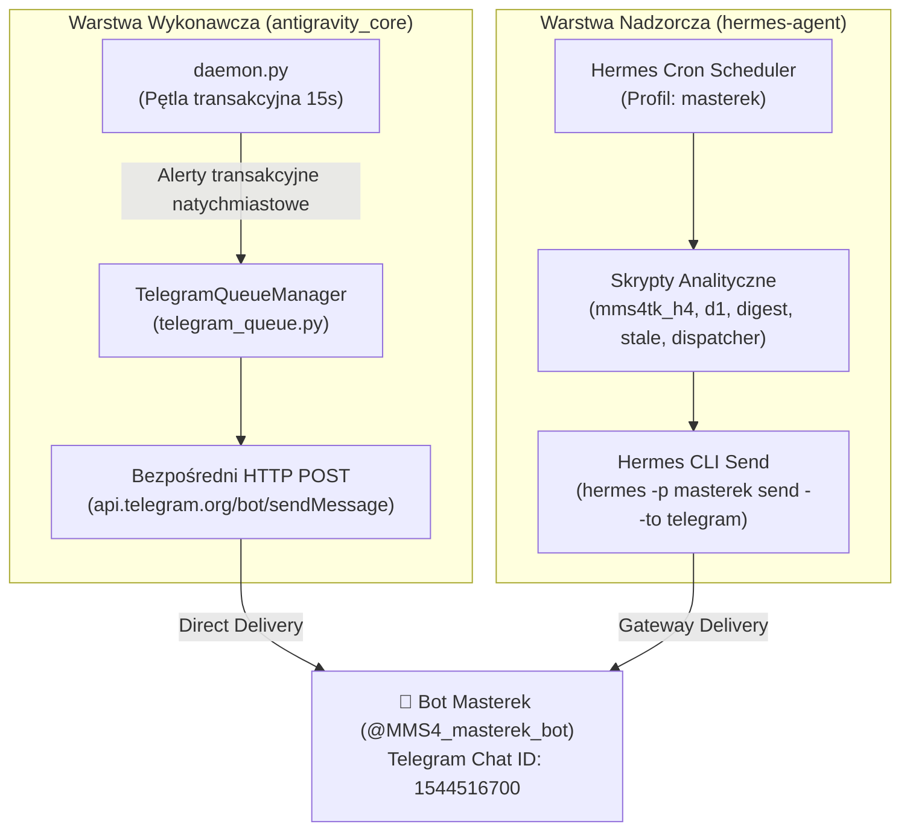

# 📡 MMS4TK — Telegram & Notifications Architecture

Dokumentacja referencyjna architektury powiadomień, routingu wiadomości oraz integracji z botami Telegram w ekosystemie MMS4TK / AGENTS-OS.

---

## 1. Zarys Architektury i Separacja Odpowiedzialności (Dual-Path Dispatch)

W systemie **mms4tk** powiadomienia są emitowane dwoma całkowicie niezależnymi kanałami:



---

## 2. Ścieżka 1: Bezpośredni Dispatch z Silnika (`daemon.py` → `TelegramQueueManager`)

### Rola i Zakres
Ścieżka ta odpowiada za **natychmiastowe alerty wykonawcze**, które muszą dotrzeć do operatora w ułamku sekundy po zajściu zdarzenia rynkowego na giełdzie OKX:
- `POSITION_OPENED`: Wejście bazowe (`BASE_LONG` / `BASE_SHORT`) oraz dokupki (`HIGH_RISK_ADD`), w tym symbol, cena wejścia, rozmiar kontraktów i notional USD.
- `POSITION_CLOSED`: Zamknięcie pozycji (Take Profit, Midline TP, Stop Loss, Inactivity Stagnation, Stale Force Close) wraz z zrealizowanym PnL netto USD i stopą zwrotu.
- `PROFIT_GIVEBACK_SPLIT`: Zabezpieczenie zysku (`SPLIT_50`) przy cofnięciu >50% ze szczytu profitu ATR.
- `CRITICAL_ERROR`: Błędy połączenia z giełdą OKX, odrzucenia zleceń (np. insufficient margin) lub błędy margin guard.

### Mechanizm Techniczny (`src/mms4tk/telegram_queue.py`)
1. **Kolejkowanie i Wątek Tła**:
   - `TelegramQueueManager` wykorzystuje bezpieczną wątkowo kolejkę priorytetową `queue.PriorityQueue()`.
   - Wątek demona `TelegramQueueWorker` (uruchamiany w `_start_worker()`, `daemon=True`) opróżnia kolejkę i wymusza interwały rate-limiting (domyślnie min. 3.0s między wiadomościami) oraz deduplikację hashującą (TTL 60s).
2. **Bezpośrednie Połączenie HTTP (Zero-Dependency)**:
   - Metoda `_send_via_bot_api(notify_msg)` wykonuje bezpośredni call `httpx.post` do oficjalnego Telegram Bot API:
     ```python
     resp = httpx.post(
         f"https://api.telegram.org/bot{token}/sendMessage",
         json={"chat_id": chat_id, "text": notify_msg[:4096]},
         timeout=10.0,
     )
     ```
   - Dzięki temu kontener `antigravity_core` **nie wymaga** dostępu do binarki `hermes`, socketu dockera ani innych kontenerów.

### Precyzyjny Odczyt Ceny Wykonania i PnL (Authoritative Fill Reconciliation — v0.47.2)
Przed wersją v0.47.2 proces pojednania pozycji w `daemon.py` (`_reconcile_positions()`) przy wykryciu zniknięcia pozycji z giełdy odczytywał bieżącą cenę tickera z rynku (`current_price`). Jeśli cena po realizacji zlecenia Stop-Loss odbiła w górę, powodowało to dwa problemy:
1. **Błędną klasyfikację zdarzenia**: Obliczony ruch niekorzystny (`adverse_move`) był zaniżony (np. -1.35% zamiast rzeczywistego -2.03%), przez co giełdowy Stop-Loss był fałszywie klasyfikowany jako `Manual/TP`.
2. **Rozjazd kwot na Telegramie**: Alert wysyłał szacowany PnL i cenę tickera z dopiskiem `(szac.)`, różniący się od rzeczywistego wyniku na OKX i w Wykazie Transakcji w UI.

**Od wersji v0.47.2**:
- `_reconcile_positions()` odpytuje giełdę OKX metodą `OKXExecutor.fetch_last_closing_order(symbol, side)` (`private_get_trade_orders_history`).
- Pobierana jest rzeczywista cena wykonania (`avgPx`), autorytatywny zrealizowany PnL (`pnl_usd`) oraz prowizja (`fee_usd`).
- Jeśli znaleziono zlecenie giełdowe (`is_real_fill=True`):
  - Ruch cenowy i próg Stop-Lossa wyliczane są z dokładnej ceny wyjścia, gwarantując 100% poprawną klasyfikację `🛑 STOP-LOSS`.
  - W powiadomieniu Telegram znika dopisek `(szac.)` — kwoty Netto, Brutto i Fee są identyczne z giełdą OKX i UI Dashboardem.
- Jeśli OKX API jest chwilowo niedostępne, system zachowuje bezpieczny fallback do ceny tickera z flagą `is_real_fill=False` i oznaczeniem `(szac.)`.

### Źródło Konfiguracji & Zasada Recreate
- Token i Chat ID są wstrzykiwane do kontenera ze zmiennych środowiskowych:
  - `TELEGRAM_BOT_TOKEN`: Token bota **Masterek** (`8851742516:AAExUxxCqIzebCXy_OHiekAFKHklALiJJjw`).
  - `TELEGRAM_CHAT_ID`: `1544516700`.
- ⚠️ **KRYTYCZNA REGUŁA DLA AGENTÓW I DEVOPS**:
  - W pliku `/docker/mms4tk/.env` na VPS zmienna `TELEGRAM_BOT_TOKEN` **musi wskazywać wyłącznie na bota Masterek**.
  - W Docker Compose samo polecenie `docker restart antigravity_core` **NIE przeładowuje** zmiennych środowiskowych z `.env`! Po edycji konfiguracji środowiska należy bezwzględnie zrekonstruować kontener:
    ```bash
    cd /docker/mms4tk && docker compose up -d antigravity_core ui_dashboard
    ```

---

## 3. Ścieżka 2: Nadzór Analityczny Hermes (`scripts/hermes/`)

### Rola i Zakres
Ścieżka okresowych raportów i analiz wyższych interwałów, realizowana przez proces `hermes gateway run` pod dedykowanym profilem **`masterek`**:
1. `mms4tk H4 Analysis` (`0 */4 * * *`, skrypt `mms4tk_h4_analysis.py`):
   - Analiza formacji świecowej H4 dla wszystkich par portfela (`BTC`, `ETH`, `XAU`, `XAG`).
   - Weryfikacja Liquidity Sweep Rejection vs Marubozu Breakout oraz ustalanie biasu kierunkowego (`LONG_ONLY`, `SHORT_ONLY`, `BOTH`).
2. `mms4tk D1 ATR Monitor` (`8 0 * * *`, skrypt `mms4tk_d1_atr_check.py`):
   - Dobowy filtr zmienności makro (ekspansja świecy D1 >2.5x ATR blokująca agresywne dokupki).
3. `mms4tk Multi-Symbol Digest` (`30 2,6,10,14,18,22 * * *`, skrypt `mms4tk_multi_symbol_digest.py`):
   - Zbiorczy digest kondycji portfela, ekspozycji notional, salda OKX oraz uPnL.
4. `mms4tk STALE Watch` (`*/15 * * * *`, skrypt `mms4tk_stale_watch.py`):
   - Cichy strażnik (silent watchdog): alarmuje wyłącznie przy wykryciu pozycji przetrzymywanej ponad dopuszczalny próg świec.
5. `mms4tk Event Dispatcher` (`* * * * *`, skrypt `mms4tk_event_dispatcher.py`):
   - Odbiera wewnętrzne webhooki i zarządza kartami w Hermes Kanban.
   - Wysłanie powiadomień Telegram wymusza profil `-p masterek`:
     ```python
     hermes_cli = os.getenv("HERMES_CLI_PATH", "hermes")
     cmd = [hermes_cli, "-p", "masterek", "send", "--to", "telegram", alert_msg]
     ```

---

## 4. Matryca Triady Botów Telegram na VPS (Standard Architektury)

W celu wyeliminowania kolizji tokenów i halucynacji krzyżowych środowisko zostało podzielone na 3 odrębne profile:

| Profil Hermesa | Nazwa Bota | Uchwyt Telegram | ID Tokena | Port API | Rola i Uprawnienia |
| :--- | :--- | :--- | :--- | :--- | :--- |
| **`default`** | Hermes Agent | `@hermes_h257d665t5aa7a2c_bot` | `8858946894` | `8643` | Główny Koordynator, DevOps, monitorowanie VPS, Traefik, Docker |
| **`masterek`** | Masterek | `@MMS4_masterek_bot` | `8851742516` | `8644` | Dedykowany Supervisor Tradingu MMS v4 (OKX: BTC, ETH, XAU, XAG) |
| **`senti`** | Senti | `@Senti_tk_bot` | `8638368161` | `8645` | Dedykowany Analityk GPW i Portfela Długoterminowego Sentinel |

### Zasada Izolacji:
- Żadne zadanie tradingowe MMS4 nie może znajdować się w profilu `default`.
- Żadne powiadomienie transakcyjne z `antigravity_core` nie ma prawa trafić do bota `default`.
- Wszystkie skille niezwiązane z tradingiem (np. GPW, Trello, Smart-Home) są usunięte z profilu `masterek`, zapewniając oszczędność tokenów i czysty kontekst decyzyjny.
