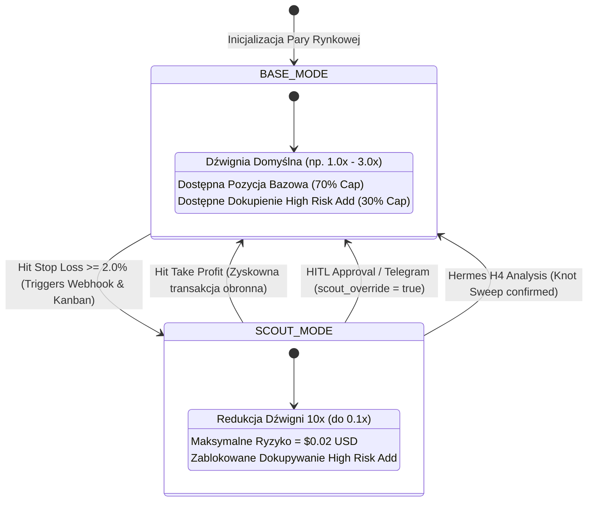

# 🗺️ PEŁNY DIAGRAM MERMAID: STRATEGIA MASTERMIND (MMS v4) ORAZ ARCHITEKTURA APLIKACJI MMS4TK

**Wersja:** 0.16.0  
**Data opracowania:** 14 sierpnia 2026 r.  
**Plik źródłowy:** `docs/mms4_mastermind_full_strategy_and_architecture.md`

---

## 🏛️ 1. PEŁNY DIAGRAM PROCESOWO-ARCHITEKTONICZNY (COMPREHENSIVE MERMAID DIAGRAM)

Ten diagram przedstawia pełny obieg informacji i logiki transakcyjnej – od interfejsu użytkownika, poprzez warstwę API, pętlę egzekucyjną bota, wyliczanie wskaźników TMA/ATR, maszynę stanów, komunikację z giełdą OKX, aż po zewnętrzny system nadzoru agentów Hermes i powiadomienia Telegram.

```mermaid
flowchart TD
    %% ─────────────────────────────────────────────────────────────────────────
    %% WARSTWA 1: INTERFEJS UŻYTKOWNIKA I API REST
    %% ─────────────────────────────────────────────────────────────────────────
    subgraph UI["1. WARSTWA USER INTERFACE (React / Vite Web Dashboard)"]
        A1["Dashboard Web UI / PWA App\n(v0.16.0 Header & Tabs)"]
        A2["Zarządzanie Parami\n(Multi-Symbol Manager)"]
        A3["Live Monitoring Grid\n(Alokacja $, Interwał 15m, Lewar)"]
        A4["Ustawienia Globalne\n(Dźwignia 1-10x, SL %, Scout Mode)"]

        A1 --> A2
        A1 --> A3
        A1 --> A4
    end

    subgraph API["2. BRAMKA API REST (FastAPI / uvicorn)"]
        B1["GET /api/v1/health\nGET /api/v1/state"]
        B2["GET/POST /api/v1/symbols\n(dynamiczne dodawanie & zmiana 15m)"]
        B3["POST /api/v1/settings/update\nPOST /api/v1/hermes/webhook"]
        B4["GET /api/v1/stats/pnl\nGET /api/v1/history/trades"]
    end

    UI -->|"HTTP / REST API requests"| API

    %% ─────────────────────────────────────────────────────────────────────────
    %% WARSTWA 2: CORE AUTOTRADING ENGINE (MMS4Daemon & Analytics)
    %% ─────────────────────────────────────────────────────────────────────────
    subgraph ENGINE["3. SILNIK AUTOTRADINGU (MMS4Daemon & Analytics Engine)"]
        C1["MMS4Daemon Run Loop\n(Pętla asynchroniczna co 15s)"]
        C2["Multi-Symbol Iteration\n[BTC/USDC, ETH/USDC, SOL/USDC, ICP/USDC]"]
        C3["Pobranie Świecer z OKX\n(Domyślnie Timeframe='15m', Limit=100)"]
        
        C1 --> C2 --> C3

        subgraph QUANT["Wyliczanie Wskaźników (TMAIndicator & ATR)"]
            D1["Utwardzone Świece: candles[:-1]\n(Brak look-ahead bias)"]
            D2["TMA = SMA(SMA(close, 10), 10)\nDouble Smooth SMA"]
            D3["ATR(14) = SMA(True Range, 14)"]
            D4["Wstęga Górna (Upper) = TMA + 2.0 * ATR\nWstęga Dolna (Lower) = TMA - 2.0 * ATR"]
            
            D1 --> D2 & D3 --> D4
        end

        C3 --> D1

        subgraph EVAL["Ocena Sygnałów (MMS4SignalEngine)"]
            E1{"Czy Cena Przebija Wstęgi ATR?"}
            E2["Cena Low <= Lower Band\n-> Kandydat BASE_LONG"]
            E3["Cena High >= Upper Band\n-> Kandydat BASE_SHORT"]
            E4["Cena wewnątrz wstęg\n-> Sygnał NO_ACTION"]

            E1 -->|Wybiła dół| E2
            E1 -->|Wybiła górę| E3
            E1 -->|Wewnątrz| E4
        end

        D4 --> E1
    end

    %% ─────────────────────────────────────────────────────────────────────────
    %% WARSTWA 3: MASZYNA STANÓW, ZASADY RYZYKA I ALOKACJA KAPITAŁOWA
    %% ─────────────────────────────────────────────────────────────────────────
    subgraph STATE_MGR["4. MASZYNA STANÓW I ALOKACJA 70/30 (MMS4StateManager)"]
        F1{"Filtr Kierunkowy\n(directional_bias)"}
        F2["LONG_ONLY / SHORT_ONLY / BOTH"]
        F3{"Stan Symbolu & Risk Profile"}
        
        F1 --> F2 --> F3

        subgraph CAP_SPLIT["Podział Kapitału (70/30 Capital Split)"]
            G1["Limit Całkowity: MMS4_MAX_MARGIN_USD\n(np. $10.00 USD per Symbol)"]
            G2["Pozycja Bazowa (Base Order):\n70% Alokacji ($7.00 USD) | SL = 2.0%"]
            G3["Dokupienie (High Risk Addon):\n30% Alokacji ($3.00 USD) | SL = 1.25%"]
            
            G1 --> G2 & G3
        end

        F3 -->|BASE_MODE (Pełna ekspozycja 1.0x)| G2
        F3 -->|SCOUT_MODE (Tryb Obronny)| H1["Redukcja Lewaru 10x (do 0.1x)\nMax Ryzyko = $0.02 USD"]
    end

    E2 & E3 --> F1

    %% ─────────────────────────────────────────────────────────────────────────
    %% WARSTWA 4: EGZEKUCJA GIEŁDOWA OKX I PERSYSTENCJA
    %% ─────────────────────────────────────────────────────────────────────────
    subgraph OKX_EXEC["5. EGZEKUCJA ZLECEŃ I PERSYSTENCJA (OKXExecutor & LoggerDB)"]
        H2["OKX Perpetual Swaps API\n(CCXT async_support)"]
        H3["Złożenie Zlecenia Rynkowego\n(Side BUY/SELL, Amount, Leverage)"]
        H4["Ustawienie Stop Loss (SL 2.0%)\nna Giełdzie OKX"]
        H5["Zapis w Bazie Bazy SQLite (logger_db)\n[log_cycle, log_trade, log_metrics]"]

        G2 & G3 & H1 --> H2 --> H3 --> H4 --> H5
    end

    %% ─────────────────────────────────────────────────────────────────────────
    %% WARSTWA 5: NADZÓR AGENTÓW HERMES I TELEGRAM PUSH
    %% ─────────────────────────────────────────────────────────────────────────
    subgraph HERMES["6. NADZÓR AGENTÓW HERMES & TELEGRAM (H4/D1 Supervisor)"]
        J1["Emisja Webhooka przy Aktywacji SCOUT_MODE\n(POST /api/v1/hermes/webhook)"]
        J2["Cron H4 Analysis (co 4h)\nOcena Świecy H4: Liquidity Sweep vs Marubozu"]
        J3["Cron D1 ATR Monitor (00:05 UTC)\nSprawdzenie overextension (>2.5x ATR_D1)"]
        J4["Tworzenie Kart w Hermes Kanban (kanban.db)"]
        J5["Telegram Push Notification\n(Baza raportów i powiadomień)"]
        J6["Decyzja Użytkownika (HITL)\n[POST /api/v1/hermes/hitl_resolve]"]

        J1 --> J4 --> J5 --> J6
        J2 & J3 --> J4
        J6 -->|"Złagodzenie/Przywrócenie Stany"| F3
    end

    H4 -->|Hit Stop Loss >= 2%| J1
    H5 -->|"Hermes Multi-Symbol Digest Cron (0 * * * *)"| J5

    %% Style i Koloryzacja
    classDef uiStyle fill:#1e293b,stroke:#3b82f6,stroke-width:2px,color:#f8fafc;
    classDef apiStyle fill:#0f172a,stroke:#06b6d4,stroke-width:2px,color:#f8fafc;
    classDef engineStyle fill:#111827,stroke:#10b981,stroke-width:2px,color:#f8fafc;
    classDef quantStyle fill:#064e3b,stroke:#34d399,stroke-width:1px,color:#f8fafc;
    classDef stateStyle fill:#312e81,stroke:#6366f1,stroke-width:2px,color:#f8fafc;
    classDef okxStyle fill:#451a03,stroke:#f59e0b,stroke-width:2px,color:#f8fafc;
    classDef hermesStyle fill:#4c1d95,stroke:#a855f7,stroke-width:2px,color:#f8fafc;

    class A1,A2,A3,A4 uiStyle;
    class B1,B2,B3,B4 apiStyle;
    class C1,C2,C3,E1,E2,E3,E4 engineStyle;
    class D1,D2,D3,D4 quantStyle;
    class F1,F2,F3,G1,G2,G3,H1 stateStyle;
    class H2,H3,H4,H5 okxStyle;
    class J1,J2,J3,J4,J5,J6 hermesStyle;
```

---

## 📐 2. DIAGRAM ARCHITEKTURY DRZEWA STANÓW (STATE MACHINE DIAGRAM)

Diagram klasyfikuje mechanizm obronny `SCOUT_MODE` oraz przejścia stanów w zależności od zdarzeń rynkowych i decyzji zarządczej:



---

## 📋 3. OPIS POZSTAŁYCH ZASAD STRATEGII MASTERMIND (MMS v4)

### A. Model Alokacji 70/30 (Capital Split & Margin Guard)
- **Zmienna Limitu**: `MMS4_MAX_MARGIN_USD` (np. `$10.00 USD`).
- **Wartość Pozycji Bazowej**: $70\% \times \$10.00 = \mathbf{\$7.00 \text{ USD}}$ ze sztywnym SL = **`2.0%`**.
- **Wartość Dokupienia (`High Risk Add`)**: $30\% \times \$10.00 = \mathbf{\$3.00 \text{ USD}}$ ze sztywnym SL = **`1.25%`**.
- **Maksymalna Łączna Strata przy SL**:
  $$\text{Max Loss} = (7.00 \times 0.02) + (3.00 \times 0.0125) = 0.14 + 0.0375 = \mathbf{0.1775 \text{ USD}} \quad (\sim 18 \text{ centów})$$

### B. Wybór Interwału Czasowego (`timeframe: "15m"`)
- **Swing Timeframe (`15m`)**: Zapobiega mikro-szumom 1-minutowym i zapewnia **~46 czystych sygnałów na dobę** dla 4 głównych par (`BTC`, `ETH`, `SOL`, `ICP`).
- **Analiza na Świecach Zamkniętych (`candles[:-1]`)**: Chroni system przed fałszywymi sygnałami w trakcie trwania świecy.

### C. Nadzór Agenta Hermes i Human-in-the-Loop (HITL)
- **H4 Liquidity Sweep Analysis**: Sprawdza, czy wybicie świecy H4 było sztucznym zebraniem płynności (knot), czy trwałym przełamaniem trendu (Marubozu).
- **D1 ATR Overextension**: Monitoruje, czy ruch dzienny nie przekroczył $2.5 \times \text{ATR\_D1}$.
- **Telegram Digest & Alerts**: Skrypt `mms4tk_multi_symbol_digest.py` wysyła co godzinę czytelny raport stanu floty na Telegram użytkownika.
